> Links: [[README]] · [[04-requisitos-funcionais]] · [[07-dicionario-de-dados]]

# 3. Diagrama Entidade-Relacionamento (DER)

## 3.1. Apresentação

Este capítulo descreve o modelo lógico de dados do sistema **Estacionamento Kaneko**, em conformidade com o esquema físico definido em `database/schema.sql` (PostgreSQL 17, banco `estacionamento_kaneko`). O modelo cobre a totalidade das **31 (trinta e uma) entidades** persistentes do sistema, distribuídas nos seguintes domínios funcionais:

1. **Geografia** — `pais`, `estado`, `cidade`.
2. **Recursos Humanos** — `cargo`, `funcionario`.
3. **Acesso ao Sistema** — `usuario`.
4. **Pagamento** — `forma_pagamento`, `condicao_pagamento`, `parcela_condicao_pagamento`.
5. **Parceiros de Negócio** — `fornecedor`, `cliente`, `fornecedor_email`, `fornecedor_telefone`.
6. **Núcleo do Estacionamento** — `veiculo`, `tarifa`, `mensalista`, `movimentacao`.
7. **Cadastros de Produto/Serviço** — `categoria`, `marca`, `unidade_medida`, `servico`, `produto`, `produto_fornecedor`.
8. **Documentos Fiscais** — `nota_entrada`, `item_nota_entrada`, `nota_saida`, `item_nota_saida`, `nota_servico`.
9. **Financeiro** — `conta_pagar`, `conta_receber`, `contas_pagar_avulsa`.

Todas as entidades adotam chave primária artificial (surrogate key) do tipo `BIGINT GENERATED BY DEFAULT AS IDENTITY` e mantêm os atributos de auditoria temporal `created_at` e `updated_at` (`TIMESTAMPTZ`, padrão `now()`), os quais foram suprimidos do diagrama por serem transversais a todas as tabelas. A integridade referencial é majoritariamente preservada por meio da política `ON DELETE RESTRICT`, com exceções pontuais em entidades de detalhe e contato, que adotam `ON DELETE CASCADE` (itens de nota, parcelas de condição e contatos de fornecedor) ou `ON DELETE SET NULL` (forma de pagamento específica de parcela).

## 3.2. Diagrama Entidade-Relacionamento (Mermaid)

O diagrama a seguir representa as 31 entidades e os respectivos relacionamentos, com a indicação de cardinalidade. A notação adotada é a de pé-de-galinha (crow's foot) do Mermaid, onde `||` denota exatamente um, `o{` denota zero ou muitos, `|{` denota um ou muitos e `o|` denota zero ou um. Cada aresta recebe um rótulo verbal que descreve a semântica do relacionamento.

```mermaid
erDiagram
    PAIS ||--o{ ESTADO : "possui"
    ESTADO ||--o{ CIDADE : "possui"

    PAIS ||--o{ FUNCIONARIO : "nacionalidade_de"
    PAIS ||--o{ FORNECEDOR : "nacionalidade_de"
    PAIS ||--o{ CLIENTE : "nacionalidade_de"

    CIDADE ||--o{ FUNCIONARIO : "localiza"
    CIDADE ||--o{ FORNECEDOR : "localiza"
    CIDADE ||--o{ CLIENTE : "localiza"

    CARGO ||--o{ FUNCIONARIO : "classifica"
    FUNCIONARIO ||--o| USUARIO : "opera_como"

    CONDICAO_PAGAMENTO ||--o{ PARCELA_CONDICAO_PAGAMENTO : "detalha"
    FORMA_PAGAMENTO ||--o{ PARCELA_CONDICAO_PAGAMENTO : "define_forma_de"

    CONDICAO_PAGAMENTO ||--o{ FORNECEDOR : "padrao_de"
    CONDICAO_PAGAMENTO ||--o{ CLIENTE : "padrao_de"

    FORNECEDOR ||--o{ FORNECEDOR_EMAIL : "tem_email"
    FORNECEDOR ||--o{ FORNECEDOR_TELEFONE : "tem_telefone"

    CLIENTE ||--o{ VEICULO : "possui"
    CLIENTE ||--o{ MENSALISTA : "contrata"
    VEICULO ||--o{ MENSALISTA : "vinculado_em"

    VEICULO ||--o{ MOVIMENTACAO : "movimenta"
    MENSALISTA ||--o{ MOVIMENTACAO : "ampara"
    TARIFA ||--o{ MOVIMENTACAO : "tarifa_de"

    MARCA ||--o{ PRODUTO : "fabrica"
    UNIDADE_MEDIDA ||--o{ PRODUTO : "mede"
    CATEGORIA ||--o{ PRODUTO : "agrupa"

    PRODUTO ||--o{ PRODUTO_FORNECEDOR : "fornecido_por"
    FORNECEDOR ||--o{ PRODUTO_FORNECEDOR : "fornece"

    FORNECEDOR ||--o{ NOTA_ENTRADA : "emite"
    CONDICAO_PAGAMENTO ||--o{ NOTA_ENTRADA : "condiciona"
    NOTA_ENTRADA ||--o{ ITEM_NOTA_ENTRADA : "compoe"
    PRODUTO ||--o{ ITEM_NOTA_ENTRADA : "referencia"

    CLIENTE ||--o{ NOTA_SAIDA : "destina_se_a"
    CONDICAO_PAGAMENTO ||--o{ NOTA_SAIDA : "condiciona"
    NOTA_SAIDA ||--o{ ITEM_NOTA_SAIDA : "compoe"
    PRODUTO ||--o{ ITEM_NOTA_SAIDA : "referencia"

    CLIENTE ||--o{ NOTA_SERVICO : "tomador_de"
    SERVICO ||--o{ NOTA_SERVICO : "tipo_de"
    MOVIMENTACAO ||--o{ NOTA_SERVICO : "origina_avulsa"
    MENSALISTA ||--o{ NOTA_SERVICO : "origina_mensal"
    CONDICAO_PAGAMENTO ||--o{ NOTA_SERVICO : "condiciona"
    FORMA_PAGAMENTO ||--o{ NOTA_SERVICO : "liquida"

    FORNECEDOR ||--o{ CONTA_PAGAR : "credor_de"
    NOTA_ENTRADA ||--o{ CONTA_PAGAR : "gera"
    CONDICAO_PAGAMENTO ||--o{ CONTA_PAGAR : "condiciona"
    FORMA_PAGAMENTO ||--o{ CONTA_PAGAR : "liquida"

    CLIENTE ||--o{ CONTA_RECEBER : "devedor_de"
    NOTA_SAIDA ||--o{ CONTA_RECEBER : "gera"
    MENSALISTA ||--o{ CONTA_RECEBER : "gera_mensalidade"
    CONDICAO_PAGAMENTO ||--o{ CONTA_RECEBER : "condiciona"
    FORMA_PAGAMENTO ||--o{ CONTA_RECEBER : "liquida"

    FORNECEDOR ||--o{ CONTAS_PAGAR_AVULSA : "credor_de"
    FORMA_PAGAMENTO ||--o{ CONTAS_PAGAR_AVULSA : "liquida"

    PAIS {
        bigint id PK
        varchar nome UK
        varchar sigla
        varchar nacionalidade
        boolean ativo
    }
    ESTADO {
        bigint id PK
        varchar nome
        varchar uf
        bigint pais_id FK
    }
    CIDADE {
        bigint id PK
        varchar nome
        varchar codigo_ibge
        bigint estado_id FK
    }
    CARGO {
        bigint id PK
        varchar nome UK
        numeric salario_base
        boolean requer_cnh
    }
    FUNCIONARIO {
        bigint id PK
        varchar nome
        varchar cpf UK
        bigint cargo_id FK
        bigint cidade_id FK
        bigint nacionalidade_id FK
    }
    USUARIO {
        bigint id PK
        varchar login UK
        varchar senha
        varchar perfil
        bigint funcionario_id FK
    }
    FORMA_PAGAMENTO {
        bigint id PK
        varchar nome UK
        varchar descricao
        boolean ativo
    }
    CONDICAO_PAGAMENTO {
        bigint id PK
        varchar nome UK
        integer numero_parcelas
        numeric percentual_juros
        numeric percentual_desconto
    }
    PARCELA_CONDICAO_PAGAMENTO {
        bigint id PK
        bigint condicao_pagamento_id FK
        bigint forma_pagamento_id FK
        integer numero
        numeric percentual
    }
    FORNECEDOR {
        bigint id PK
        varchar nome
        varchar documento UK
        bigint cidade_id FK
        bigint nacionalidade_id FK
        bigint condicao_pagamento_id FK
    }
    CLIENTE {
        bigint id PK
        varchar nome
        varchar documento UK
        bigint cidade_id FK
        bigint nacionalidade_id FK
        bigint condicao_pagamento_id FK
    }
    VEICULO {
        bigint id PK
        varchar placa UK
        varchar tipo
        bigint cliente_id FK
    }
    TARIFA {
        bigint id PK
        varchar descricao
        numeric valor_hora
        numeric valor_diaria
        numeric valor_mensalidade
    }
    MENSALISTA {
        bigint id PK
        bigint cliente_id FK
        bigint veiculo_id FK
        numeric valor_mensal
        varchar status
    }
    MOVIMENTACAO {
        bigint id PK
        bigint veiculo_id FK
        bigint mensalista_id FK
        bigint tarifa_id FK
        varchar tipo
        varchar status
    }
    CATEGORIA {
        bigint id PK
        varchar nome UK
        boolean ativo
    }
    MARCA {
        bigint id PK
        varchar nome UK
        boolean ativo
    }
    UNIDADE_MEDIDA {
        bigint id PK
        varchar nome
        varchar sigla UK
    }
    SERVICO {
        bigint id PK
        varchar nome UK
        numeric valor_padrao
    }
    PRODUTO {
        bigint id PK
        varchar nome
        varchar codigo_barras UK
        bigint marca_id FK
        bigint unidade_medida_id FK
        bigint categoria_id FK
    }
    PRODUTO_FORNECEDOR {
        bigint id PK
        bigint produto_id FK
        bigint fornecedor_id FK
        numeric custo
    }
    NOTA_ENTRADA {
        bigint id PK
        varchar numero
        bigint fornecedor_id FK
        bigint condicao_pagamento_id FK
        varchar situacao
    }
    ITEM_NOTA_ENTRADA {
        bigint id PK
        bigint nota_entrada_id FK
        bigint produto_id FK
        integer sequencia
        numeric quantidade
    }
    NOTA_SAIDA {
        bigint id PK
        varchar numero
        bigint cliente_id FK
        bigint condicao_pagamento_id FK
        varchar situacao
    }
    ITEM_NOTA_SAIDA {
        bigint id PK
        bigint nota_saida_id FK
        bigint produto_id FK
        integer sequencia
        numeric quantidade
    }
    NOTA_SERVICO {
        bigint id PK
        varchar numero
        bigint cliente_id FK
        bigint servico_id FK
        bigint movimentacao_id FK
        bigint mensalista_id FK
        bigint condicao_pagamento_id FK
        bigint forma_pagamento_id FK
    }
    CONTA_PAGAR {
        bigint id PK
        bigint fornecedor_id FK
        bigint nota_entrada_id FK
        bigint condicao_pagamento_id FK
        bigint forma_pagamento_id FK
        varchar situacao
    }
    CONTA_RECEBER {
        bigint id PK
        bigint cliente_id FK
        bigint nota_saida_id FK
        bigint mensalista_id FK
        bigint condicao_pagamento_id FK
        bigint forma_pagamento_id FK
        varchar situacao
    }
    CONTAS_PAGAR_AVULSA {
        bigint id PK
        varchar descricao
        bigint fornecedor_id FK
        bigint forma_pagamento_id FK
        varchar situacao
    }
    FORNECEDOR_EMAIL {
        bigint id PK
        bigint fornecedor_id FK
        varchar email
        boolean principal
    }
    FORNECEDOR_TELEFONE {
        bigint id PK
        bigint fornecedor_id FK
        varchar telefone
        boolean principal
    }
```

## 3.3. Observações sobre a Cardinalidade

A leitura das cardinalidades deve considerar a obrigatoriedade definida pelas restrições `NOT NULL` das chaves estrangeiras no esquema físico:

1. **Relacionamentos identificadores e obrigatórios** — quando a chave estrangeira é `NOT NULL`, o registro filho não existe sem o pai (por exemplo, `estado.pais_id`, `cidade.estado_id`, `funcionario.cargo_id`, `mensalista.cliente_id`, `mensalista.veiculo_id`, `item_nota_entrada.nota_entrada_id`). Nesses casos a leitura do lado "muitos" é "um ou muitos" sob a ótica de obrigatoriedade do filho, embora o pai possa não ter filhos.
2. **Relacionamentos opcionais** — quando a chave estrangeira admite valor nulo (por exemplo, `veiculo.cliente_id` para veículos avulsos, `movimentacao.mensalista_id`, `movimentacao.tarifa_id`, `usuario.funcionario_id`), o vínculo é facultativo, representado por "zero ou muitos" e, no caso de `usuario`, "zero ou um".
3. **Relacionamento um-para-um** — entre `funcionario` e `usuario` existe, no máximo, um usuário por funcionário, garantido pelo índice único parcial `uq_usuario_funcionario`, o que caracteriza cardinalidade 1:0..1.
4. **Origem exclusiva (XOR)** — em `nota_servico`, a restrição `ck_nota_servico_origem` impede que `movimentacao_id` e `mensalista_id` sejam ambos preenchidos; analogamente, `conta_receber` impede `nota_saida_id` e `mensalista_id` simultâneos (`ck_conta_receber_origem`). Trata-se de exclusividade mútua entre duas origens possíveis.
5. **Unicidade condicional de regra de negócio** — os índices únicos parciais `uq_mensalista_veiculo_ativo` (no máximo um contrato `ATIVO` por veículo) e `uq_mov_veiculo_aberta` (no máximo uma movimentação `ABERTA` por veículo) restringem a cardinalidade efetiva no plano operacional, ainda que historicamente um veículo possa acumular vários contratos e movimentações encerrados.

## 3.4. Tabela-Resumo das Entidades

A tabela abaixo consolida as 31 entidades, indicando chave primária, chaves estrangeiras, principais restrições de unicidade e verificação, e a descrição funcional de cada uma. Por padrão, todas as entidades possuem `id` como chave primária `BIGINT IDENTITY` e os campos `ativo` (quando aplicável), `created_at` e `updated_at`.

| # | Entidade | PK | Chaves Estrangeiras (FK) | Uniques / Restrições principais | Descrição |
|---|----------|----|--------------------------|----------------------------------|-----------|
| 1 | **pais** | id | — | `uq_pais_nome` (nome) | País de origem, base da hierarquia geográfica e da nacionalidade de pessoas. |
| 2 | **estado** | id | pais_id → pais | `uq_estado_uf_pais` (pais_id, uf) | Unidade federativa, com UF e vínculo ao país. |
| 3 | **cidade** | id | estado_id → estado | `uq_cidade_nome_estado` (estado_id, nome) | Município, com DDD e código IBGE, vinculado ao estado. |
| 4 | **cargo** | id | — | `uq_cargo_nome` (nome); `ck_cargo_valores` (salário e carga ≥ 0) | Função exercida pelo funcionário, com salário-base e exigência de CNH. |
| 5 | **funcionario** | id | cargo_id → cargo; cidade_id → cidade; nacionalidade_id → pais | `uq_funcionario_cpf` (cpf); checks de tipo, sexo, estado civil e salário ≥ 0 | Colaborador do estacionamento, pessoa física ou jurídica, com dados de RH. |
| 6 | **usuario** | id | funcionario_id → funcionario | `uq_usuario_login` (lower(login)); `uq_usuario_email` (parcial); `uq_usuario_funcionario` (parcial, 1:1); `ck_usuario_perfil` (ADMIN/OPERADOR) | Credencial de acesso ao sistema, opcionalmente ligada a um funcionário. |
| 7 | **forma_pagamento** | id | — | `uq_forma_pagamento_nome` (nome) | Meio de pagamento (Dinheiro, Cartão, Pix, Boleto). |
| 8 | **condicao_pagamento** | id | — | `uq_condicao_pagamento_nome` (nome); checks de parcelas e percentuais ≥ 0 | Condição comercial: número de parcelas, prazos, juros, multa e desconto. |
| 9 | **parcela_condicao_pagamento** | id | condicao_pagamento_id → condicao_pagamento (CASCADE); forma_pagamento_id → forma_pagamento (SET NULL) | `uq_parcela_condicao_numero` (condicao, numero); `ck_parcela_valores` (percentual 0–100) | Detalhamento de cada parcela de uma condição de pagamento. |
| 10 | **fornecedor** | id | cidade_id → cidade; nacionalidade_id → pais; condicao_pagamento_id → condicao_pagamento | `uq_fornecedor_documento` (documento); `ck_fornecedor_limite`; `ck_fornecedor_tipo` | Parceiro fornecedor de mercadorias e serviços, com limite de crédito. |
| 11 | **cliente** | id | cidade_id → cidade; nacionalidade_id → pais; condicao_pagamento_id → condicao_pagamento | `uq_cliente_documento` (documento); checks de tipo, sexo, estado civil e limite ≥ 0 | Cliente do estacionamento, dono de plano mensalista e tomador de notas. |
| 12 | **veiculo** | id | cliente_id → cliente | `uq_veiculo_placa` (placa); `ck_veiculo_tipo` (CARRO/MOTO) | Veículo cadastrado; cliente nulo indica veículo avulso. |
| 13 | **tarifa** | id | — | `ck_tarifa_valores` (valores ≥ 0) | Tabela de preços vigente: hora, diária, tolerância e mensalidade. |
| 14 | **mensalista** | id | cliente_id → cliente; veiculo_id → veiculo | `uq_mensalista_veiculo_ativo` (parcial: 1 ativo por veículo); `ck_mensalista_status`; `ck_mensalista_periodo` | Contrato mensal que vincula cliente e veículo, com vigência e status. |
| 15 | **movimentacao** | id | veiculo_id → veiculo; mensalista_id → mensalista; tarifa_id → tarifa | `uq_mov_veiculo_aberta` (parcial: 1 aberta por veículo); `ck_mov_tipo`; `ck_mov_status`; `ck_mov_tipo_coerencia` | Ticket de pátio (entrada/saída), avulso ou mensalista, com valor cobrado. |
| 16 | **categoria** | id | — | `uq_categoria_nome` (nome) | Categoria de agrupamento de produtos da conveniência. |
| 17 | **marca** | id | — | `uq_marca_nome` (nome) | Marca/fabricante de produtos. |
| 18 | **unidade_medida** | id | — | `uq_unidade_sigla` (sigla) | Unidade de medida (Unidade, Quilograma, Litro). |
| 19 | **servico** | id | — | `uq_servico_nome` (nome); `ck_servico_valor` (valor ≥ 0) | Tipo de serviço prestado (estacionamento avulso, mensalidade, lavagem). |
| 20 | **produto** | id | marca_id → marca; unidade_medida_id → unidade_medida; categoria_id → categoria | `uq_produto_codigo_barras` (codigo_barras); `ck_produto_valores` (valores e estoque ≥ 0) | Item de conveniência com controle de estoque, custo e preço de venda. |
| 21 | **produto_fornecedor** | id | produto_id → produto; fornecedor_id → fornecedor | `uq_produto_fornecedor` (produto, fornecedor); `ck_produto_fornecedor_custo` | Associação N:N entre produto e fornecedor, com custo e código do produto. |
| 22 | **nota_entrada** | id | fornecedor_id → fornecedor; condicao_pagamento_id → condicao_pagamento | `uq_nota_entrada` (numero, serie, fornecedor); checks de frete, situação, valores e datas | Nota de compra de mercadoria; ao confirmar, adiciona estoque. |
| 23 | **item_nota_entrada** | id | nota_entrada_id → nota_entrada (CASCADE); produto_id → produto | `uq_item_entrada_seq` (nota, sequencia); `ck_item_entrada_qtd` (qtd > 0); checks de valores | Item de uma nota de entrada, com rateios de frete, seguro e despesas. |
| 24 | **nota_saida** | id | cliente_id → cliente; condicao_pagamento_id → condicao_pagamento | `uq_nota_saida` (numero, serie, cliente); checks de frete, situação, valores e datas | Nota de venda de mercadoria; ao confirmar, baixa estoque. |
| 25 | **item_nota_saida** | id | nota_saida_id → nota_saida (CASCADE); produto_id → produto | `uq_item_saida_seq` (nota, sequencia); `ck_item_saida_qtd` (qtd > 0); checks de valores | Item de uma nota de saída, com rateios e custo final. |
| 26 | **nota_servico** | id | cliente_id → cliente; servico_id → servico; movimentacao_id → movimentacao; mensalista_id → mensalista; condicao_pagamento_id → condicao_pagamento; forma_pagamento_id → forma_pagamento | `uq_nota_servico` (numero, serie); checks de situação, ISS, alíquota e `ck_nota_servico_origem` (XOR movimentação/mensalista) | NFS-e do estacionamento (ISS), originada de movimentação avulsa ou mensalidade. |
| 27 | **conta_pagar** | id | fornecedor_id → fornecedor; nota_entrada_id → nota_entrada; condicao_pagamento_id → condicao_pagamento; forma_pagamento_id → forma_pagamento | `uq_conta_pagar_parcela` (parcial: nota, parcela); checks de parcela, valores, teto, situação, vencimento e baixa | Título a pagar (parcela), originado ou não de nota de entrada. |
| 28 | **conta_receber** | id | cliente_id → cliente; nota_saida_id → nota_saida; mensalista_id → mensalista; condicao_pagamento_id → condicao_pagamento; forma_pagamento_id → forma_pagamento | `uq_conta_receber_parcela` (parcial: nota, parcela); checks de parcela, valores, teto, situação, baixa e `ck_conta_receber_origem` (XOR nota/mensalista) | Título a receber (parcela), originado de nota de saída ou mensalidade. |
| 29 | **contas_pagar_avulsa** | id | fornecedor_id → fornecedor; forma_pagamento_id → forma_pagamento | Checks de valores, total mínimo, teto, parcela, situação, vencimento e baixa | Despesa avulsa sem nota fiscal (aluguel, luz, água, salário). |
| 30 | **fornecedor_email** | id | fornecedor_id → fornecedor (CASCADE) | `uq_fornecedor_email_principal` (parcial: 1 principal); `ck_fornecedor_email_tipo` | E-mail de contato do fornecedor, com indicação de principal. |
| 31 | **fornecedor_telefone** | id | fornecedor_id → fornecedor (CASCADE) | `uq_fornecedor_telefone_principal` (parcial: 1 principal); `ck_fornecedor_telefone_tipo` | Telefone de contato do fornecedor, com indicação de principal. |

## 3.5. Considerações de Integridade

O esquema físico privilegia a integridade de dados em nível de banco, complementando as validações da camada de aplicação. Destacam-se três mecanismos:

1. **Restrições de verificação (CHECK)** garantem a consistência de domínios enumerados (tipos, situações, perfis), a não-negatividade de valores monetários e quantitativos, a coerência temporal entre datas de emissão, vencimento, pagamento e saída, e regras de baixa de títulos (somente títulos `PAGA`/`RECEBIDA` possuem data de liquidação).
2. **Índices únicos parciais** (cláusula `WHERE`) materializam regras de negócio sensíveis ao estado, tais como o máximo de um contrato mensalista ativo e de uma movimentação aberta por veículo, além de um único e-mail e telefone principal por fornecedor.
3. **Políticas de exclusão** combinam `ON DELETE RESTRICT` para preservar referências de cadastros estruturais, `ON DELETE CASCADE` para propagar a remoção de itens e contatos dependentes, e `ON DELETE SET NULL` para desvincular a forma de pagamento específica de uma parcela sem removê-la.

## 3.6. Histórico

| Data | Ação |
|------|------|
| 2026-06-14 | Elaboração inicial da Seção 3 (DER) com diagrama Mermaid das 31 entidades, tabela-resumo e considerações de cardinalidade e integridade, aterrada em `database/schema.sql`. |
