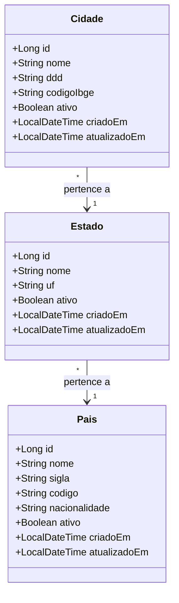
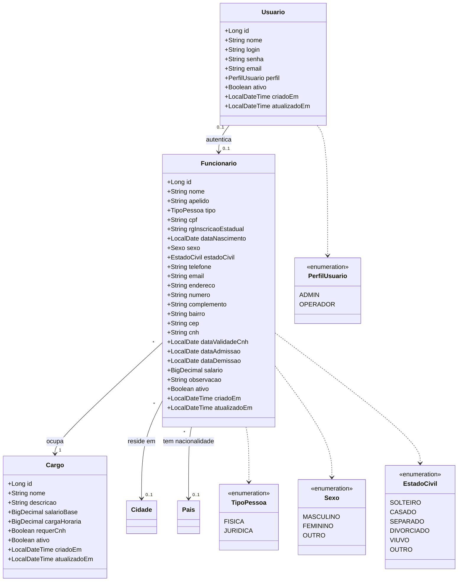
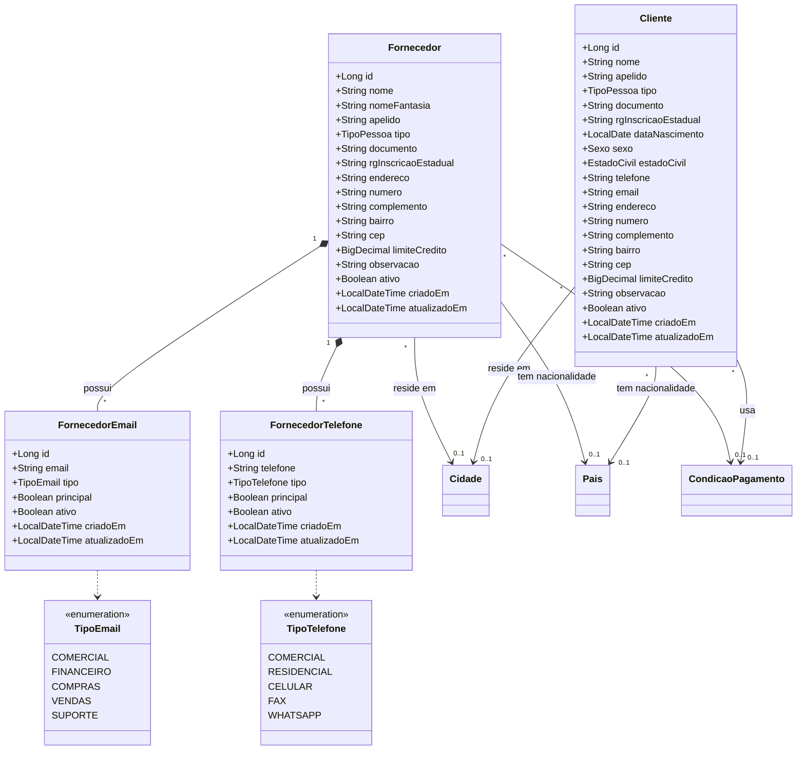
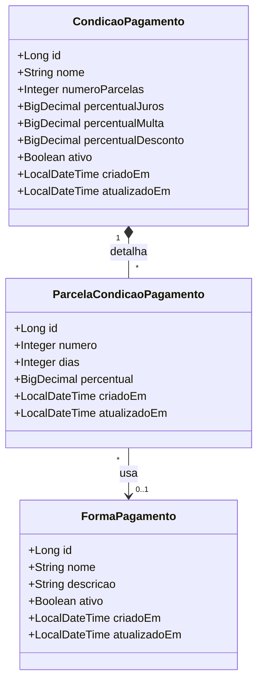
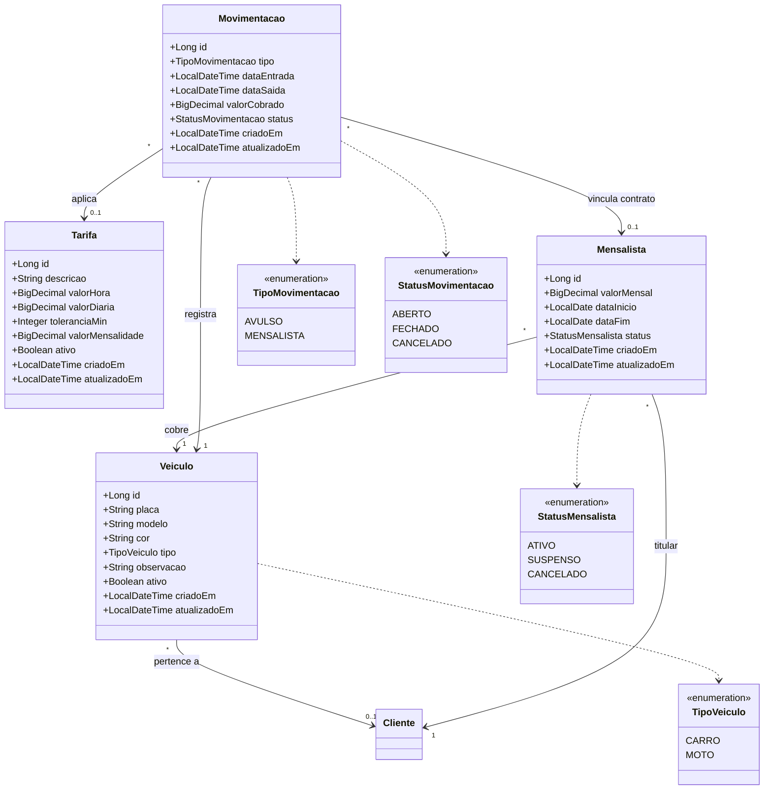
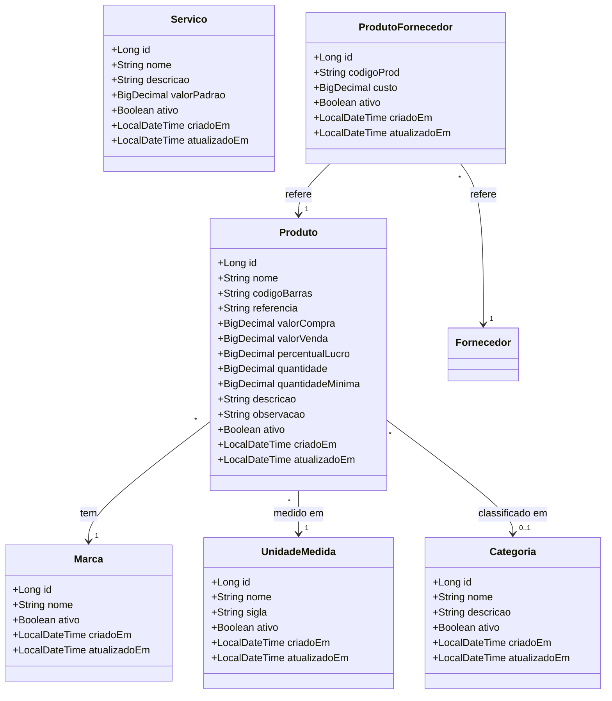
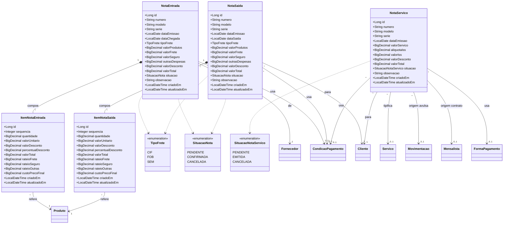
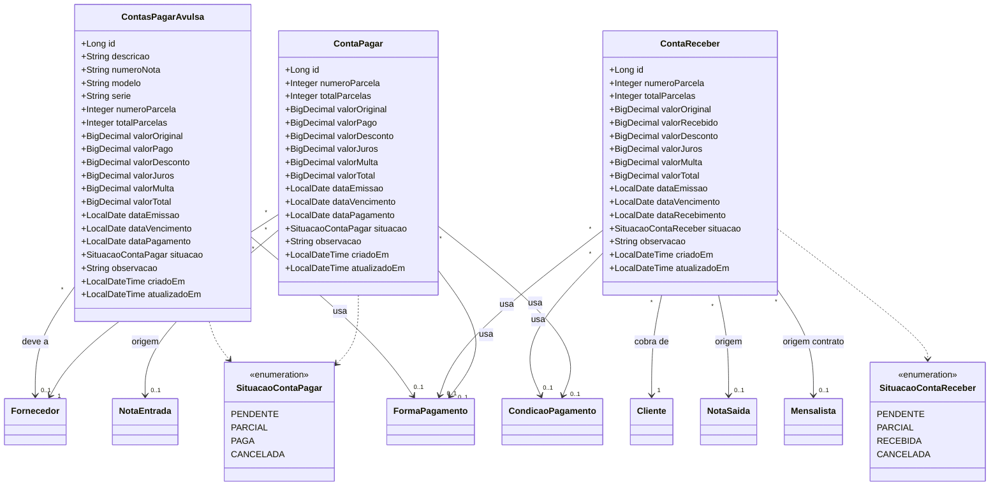

> Links: [[README]] · [[03-der]] · [[07-dicionario-de-dados]]

# 8. Diagramas de Classe (UML)

Esta seção apresenta o modelo de classes do sistema **Estacionamento Kaneko**, derivado diretamente do esquema relacional (`database/schema.sql`, 31 tabelas), que originará as entidades JPA da camada de domínio. Cada tabela é representada por uma classe em notação UML, com atributos tipados no estilo Java/JPA (`Long`, `String`, `BigDecimal`, `Integer`, `LocalDate`, `LocalDateTime`, `Boolean`) e enumerações modeladas como classes `<<enumeration>>`.

As associações refletem as chaves estrangeiras do banco, com rótulos de cardinalidade. Adotam-se as convenções:

- **Associação** (`-->`): relação por chave estrangeira navegável (ex.: `Estado "*" --> "1" Pais`).
- **Composição** (`*--`): o filho não existe sem o pai e é removido em cascata com ele — usado nos itens de nota fiscal (`ON DELETE CASCADE` no schema).
- **Dependência** (`..>`): vínculo opcional/fraco ou referência cruzada de origem.

Para legibilidade, os mapeamentos `LocalDateTime criadoEm` / `atualizadoEm` (colunas `created_at` / `updated_at`, presentes em quase todas as tabelas) e os identificadores `Long id` são exibidos nas classes, mas as auditorias temporais são omitidas nas classes onde poluiriam o diagrama sem agregar — permanecem implícitas via superclasse técnica de persistência. Os diagramas estão divididos por módulo funcional.

---

## 8.1 Módulo Geografia

Hierarquia de localização (País → Estado → Cidade), referenciada por Funcionário, Fornecedor e Cliente para composição de endereço e nacionalidade.

---

## 8.2 Módulo RH e Usuário

Cargo define a função; Funcionário é a pessoa contratada (com endereço e nacionalidade); Usuário é a credencial de acesso, vinculada opcionalmente a um Funcionário (1:1).

---

## 8.3 Módulo Pessoas (Cliente e Fornecedor)

Cliente é o dono do plano mensalista e destinatário de notas de saída/serviço. Fornecedor abastece a conveniência e gera contas a pagar; possui múltiplos e-mails e telefones (composição, `ON DELETE CASCADE`).

---

## 8.4 Módulo Pagamento

Forma de Pagamento (Dinheiro, Cartão, Pix, Boleto) e Condição de Pagamento (à vista, 30/60/90), esta última detalhada por suas Parcelas, que opcionalmente fixam uma forma específica.

---

## 8.5 Módulo Pátio

Núcleo operacional: Veículo (do Cliente quando mensalista; avulso quando sem dono), Tarifa (preços vigentes), Mensalista (contrato Cliente+Veículo) e Movimentação (o ticket de entrada/saída).

---

## 8.6 Módulo Conveniência

Cadastros de apoio do comercial (Categoria, Marca, Unidade de Medida, Serviço) e o Produto com estoque, que se associa a múltiplos Fornecedores via tabela de junção (N:N).

---

## 8.7 Módulo Fiscal

Notas fiscais e seus itens. Nota de Entrada (compra → +estoque) e Nota de Saída (venda → -estoque) compõem seus itens em cascata. Nota de Serviço (NFS-e do estacionamento, com ISS) tem origem em uma Movimentação avulsa ou em um Mensalista.

---

## 8.8 Módulo Financeiro

Títulos a pagar e a receber. Conta a Pagar nasce de Nota de Entrada (ou avulsa); Conta a Receber nasce de Nota de Saída ou de Mensalista; Conta a Pagar Avulsa cobre despesas sem nota (aluguel, luz, água, salário).

---

## 8.9 Observações de Mapeamento Objeto-Relacional

- **Auditoria temporal:** `created_at` / `updated_at` mapeiam para `LocalDateTime criadoEm` / `atualizadoEm` (`TIMESTAMPTZ` no banco), tipicamente concentrados numa superclasse `@MappedSuperclass` com `@CreationTimestamp` / `@UpdateTimestamp`.
- **Enumerações:** os campos `VARCHAR` restritos por `CHECK` no schema são mapeados como `@Enumerated(EnumType.STRING)`, preservando os valores textuais (ex.: `status`, `situacao`, `tipo`, `perfil`).
- **Identidade:** todas as PKs usam `BIGINT GENERATED BY DEFAULT AS IDENTITY`, mapeadas como `Long id` com `@GeneratedValue(strategy = IDENTITY)`.
- **Cardinalidade `0..1`:** FKs anuláveis (sem `NOT NULL`) — associações `@ManyToOne(optional = true)`; FKs `NOT NULL` viram associações obrigatórias (`1`).
- **Composição:** itens de nota (`item_nota_entrada`, `item_nota_saida`) e contatos de fornecedor (`fornecedor_email`, `fornecedor_telefone`) têm `ON DELETE CASCADE`, justificando a composição UML (`*--`) e `cascade = ALL, orphanRemoval = true`.
- **Regras de coerência:** restrições como "no máximo 1 contrato ATIVO por veículo", "no máximo 1 movimentação ABERTA por veículo" e a exclusividade de origem em `nota_servico` / `conta_receber` são invariantes de domínio, validadas na camada de serviço além dos índices parciais e `CHECK` do banco.

## 8.10 Módulos relacionados

[[03-der]] · [[07-dicionario-de-dados]] · [[04-requisitos-funcionais]] · [[02-analise-negocio]]

## 8.11 Histórico

| Data | Ação |
|------|------|
| 2026-06-15 | Criação da Seção 8 — Diagramas de Classe (UML) em Mermaid, 8 diagramas por módulo aterrados nas 31 tabelas de `database/schema.sql`. |
