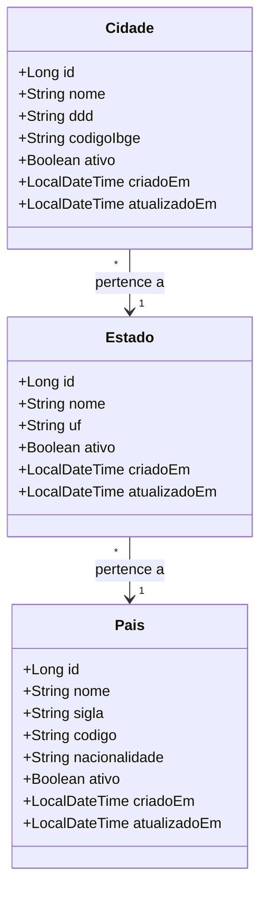
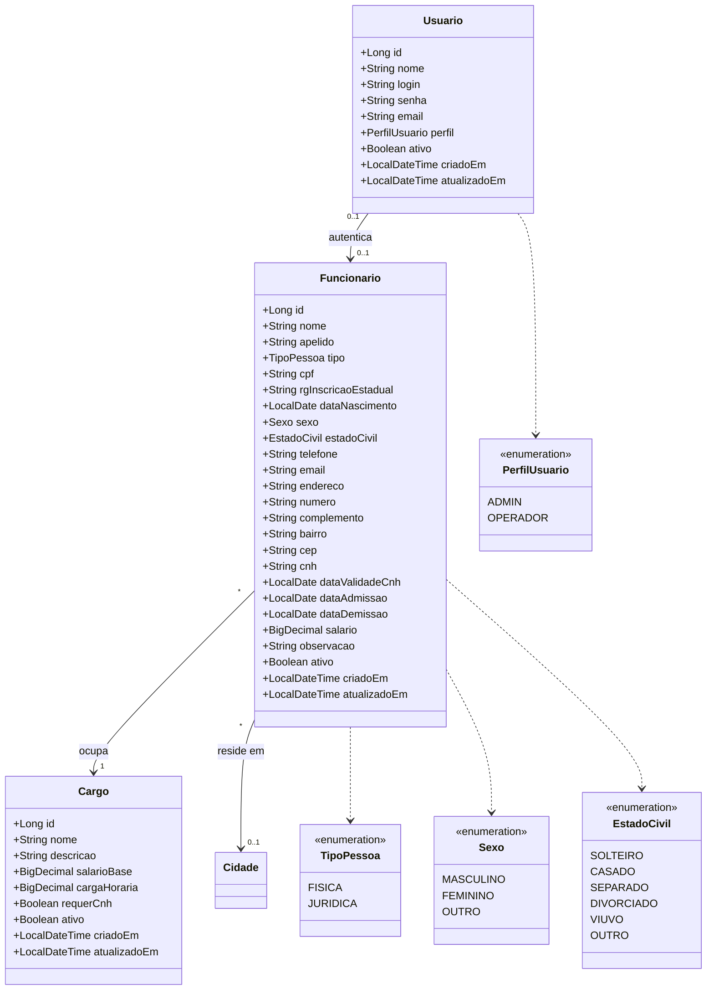
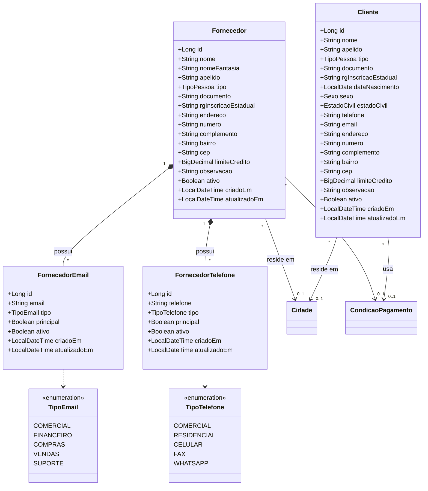
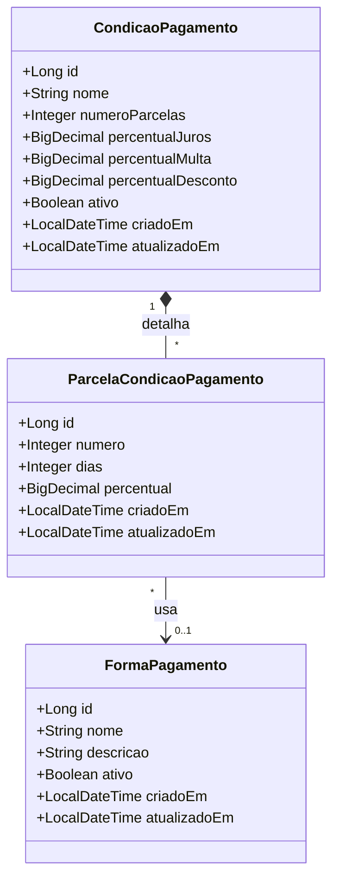
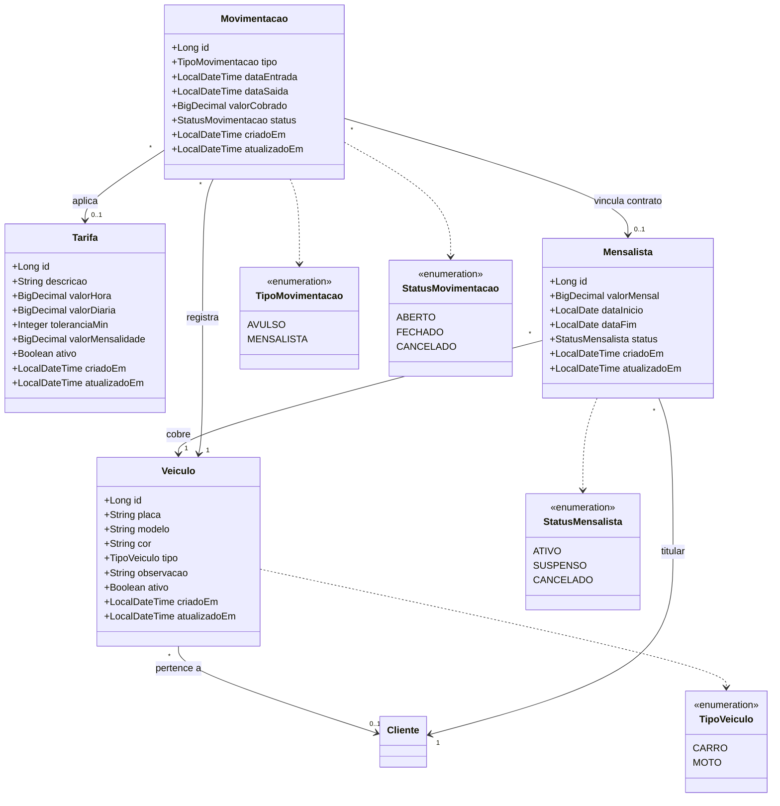
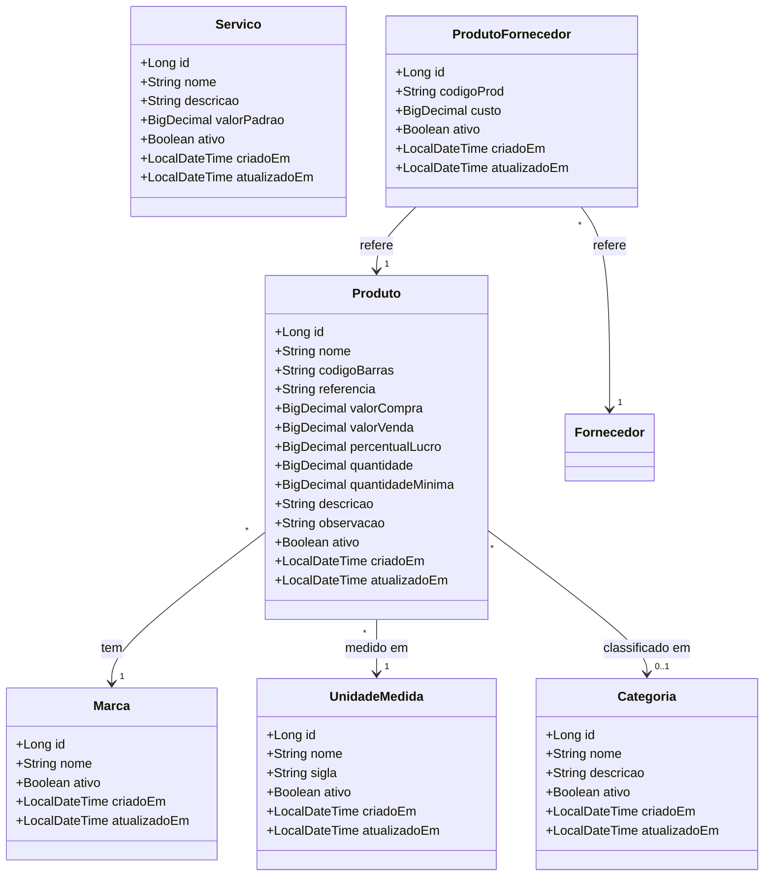
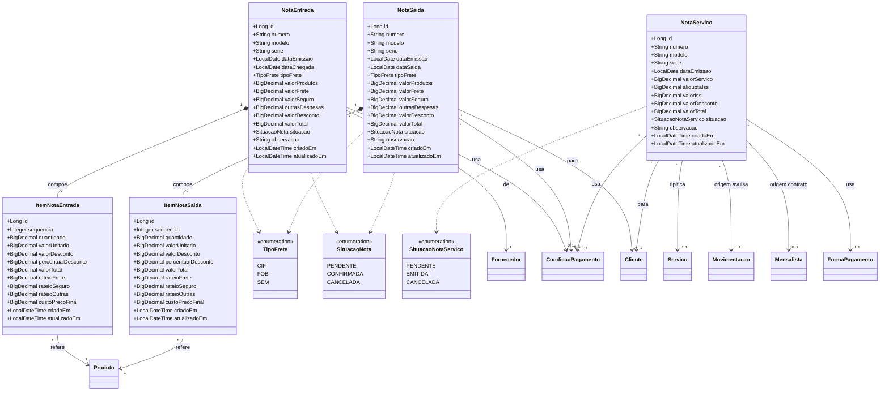
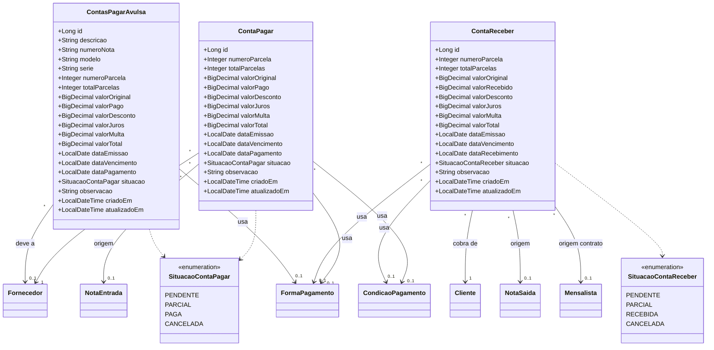
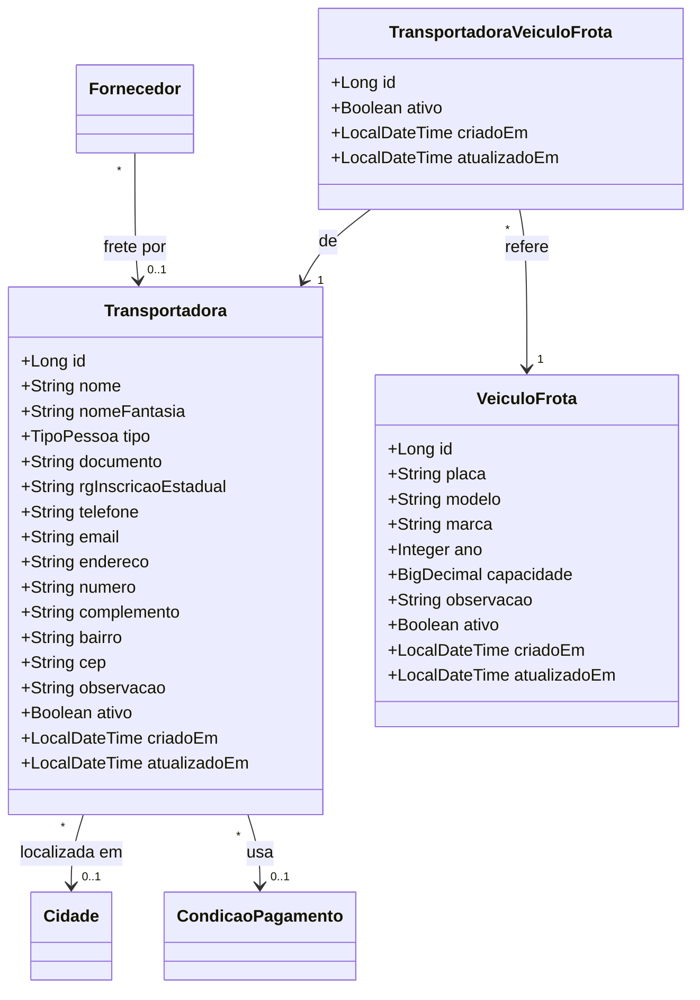
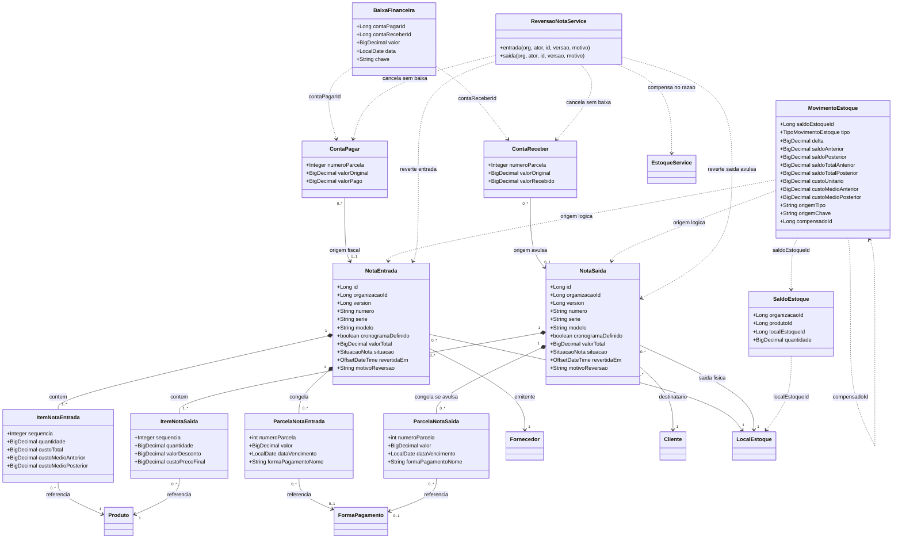

> Links: [[README]] · [[03-der]] · [[07-dicionario-de-dados]]

# 8. Diagramas de Classe (UML)

As seções 8.1 a 8.10 preservam a representação histórica de classes do **Estacionamento Kaneko**, derivada de `database/schema.sql` (34 tabelas), com atributos tipados no estilo Java/JPA e enumerações modeladas como classes `<<enumeration>>`. A seção **8.10.1** apresenta o recorte vigente das notas de mercadoria, estoque e contas multiempresa, em correspondência com o [[03-der]].

As associações refletem as chaves estrangeiras do banco, com rótulos de cardinalidade. Adotam-se as convenções:

- **Associação** (`-->`): relação por chave estrangeira navegável (ex.: `Estado "*" --> "1" Pais`).
- **Composição** (`*--`): o filho não existe sem o pai e é removido em cascata com ele — usado nos itens de nota fiscal (`ON DELETE CASCADE` no schema).
- **Dependência** (`..>`): vínculo opcional/fraco ou referência cruzada de origem.

Para legibilidade, os mapeamentos `LocalDateTime criadoEm` / `atualizadoEm` (colunas `created_at` / `updated_at`, presentes em quase todas as tabelas) e os identificadores `Long id` são exibidos nas classes, mas as auditorias temporais são omitidas nas classes onde poluiriam o diagrama sem agregar — permanecem implícitas via superclasse técnica de persistência. Os diagramas estão divididos por módulo funcional.

---

> 🖼️ **Diagrama completo do modelo histórico (alta resolução):** [`diagramas/completo.png`](diagramas/completo.png) — 14684×7854 px. Os PNGs por módulo também são históricos.

## 8.1 Módulo Geografia

Hierarquia de localização (País → Estado → Cidade), referenciada por Funcionário, Fornecedor e Cliente para composição de endereço.

> 🖼️ **Versão em imagem (PNG):** [`diagramas/8-1-geografia.png`](diagramas/8-1-geografia.png)

---

## 8.2 Módulo RH e Usuário

Cargo define a função; Funcionário é a pessoa contratada (com endereço); Usuário é a credencial de acesso, vinculada opcionalmente a um Funcionário (1:1).

> 🖼️ **Versão em imagem (PNG):** [`diagramas/8-2-rh-usuario.png`](diagramas/8-2-rh-usuario.png)

---

## 8.3 Módulo Pessoas (Cliente e Fornecedor)

Cliente é o dono do plano mensalista e destinatário de notas de saída/serviço. Fornecedor abastece a conveniência e gera contas a pagar; possui múltiplos e-mails e telefones (composição, `ON DELETE CASCADE`).

> 🖼️ **Versão em imagem (PNG):** [`diagramas/8-3-pessoas.png`](diagramas/8-3-pessoas.png)

---

## 8.4 Módulo Pagamento

Forma de Pagamento (Dinheiro, Cartão, Pix, Boleto) e Condição de Pagamento (à vista, 30/60/90), esta última detalhada por suas Parcelas, que opcionalmente fixam uma forma específica.

> 🖼️ **Versão em imagem (PNG):** [`diagramas/8-4-pagamento.png`](diagramas/8-4-pagamento.png)

---

## 8.5 Módulo Pátio

Núcleo operacional: Veículo (do Cliente quando mensalista; avulso quando sem dono), Tarifa (preços vigentes), Mensalista (contrato Cliente+Veículo) e Movimentação (o ticket de entrada/saída).

> 🖼️ **Versão em imagem (PNG):** [`diagramas/8-5-patio.png`](diagramas/8-5-patio.png)

---

## 8.6 Módulo Conveniência

Cadastros de apoio do comercial (Categoria, Marca, Unidade de Medida, Serviço) e o Produto com estoque, que se associa a múltiplos Fornecedores via tabela de junção (N:N).

> 🖼️ **Versão em imagem (PNG):** [`diagramas/8-6-conveniencia.png`](diagramas/8-6-conveniencia.png)

---

## 8.7 Módulo Fiscal

Notas fiscais e seus itens. Nota de Entrada (compra → +estoque) e Nota de Saída (venda → -estoque) compõem seus itens em cascata. Nota de Serviço (NFS-e do estacionamento, com ISS) tem origem em uma Movimentação avulsa ou em um Mensalista.

> 🖼️ **Versão em imagem (PNG):** [`diagramas/8-7-fiscal.png`](diagramas/8-7-fiscal.png)

---

## 8.8 Módulo Financeiro

Títulos a pagar e a receber. Conta a Pagar nasce de Nota de Entrada (ou avulsa); Conta a Receber nasce de Nota de Saída ou de Mensalista; Conta a Pagar Avulsa cobre despesas sem nota (aluguel, luz, água, salário).

> 🖼️ **Versão em imagem (PNG):** [`diagramas/8-8-financeiro.png`](diagramas/8-8-financeiro.png)

---

## 8.9 Módulo de Logística

Modelo estático do módulo de logística (abastecimento da conveniência): a `Transportadora` e o `VeiculoFrota`, associados em N:N pelo `TransportadoraVeiculoFrota` (a frota), com o `Fornecedor` referenciando a sua transportadora padrão de frete.

> 🖼️ **Versão em imagem (PNG):** [`diagramas/8-9-logistica.png`](diagramas/8-9-logistica.png)

Observa-se que `VeiculoFrota` é uma classe **distinta** de `Veiculo` (Seção 8.4 — pátio): o primeiro representa o veículo de carga da transportadora; o segundo, o automóvel estacionado pelo cliente. Não há associação entre ambos.

## 8.10 Observações de Mapeamento Objeto-Relacional

- **Auditoria temporal:** `created_at` / `updated_at` mapeiam para `LocalDateTime criadoEm` / `atualizadoEm` (`TIMESTAMPTZ` no banco), tipicamente concentrados numa superclasse `@MappedSuperclass` com `@CreationTimestamp` / `@UpdateTimestamp`.
- **Enumerações:** os campos `VARCHAR` restritos por `CHECK` no schema são mapeados como `@Enumerated(EnumType.STRING)`, preservando os valores textuais (ex.: `status`, `situacao`, `tipo`, `perfil`).
- **Identidade:** todas as PKs usam `BIGINT GENERATED BY DEFAULT AS IDENTITY`, mapeadas como `Long id` com `@GeneratedValue(strategy = IDENTITY)`.
- **Cardinalidade `0..1`:** FKs anuláveis (sem `NOT NULL`) — associações `@ManyToOne(optional = true)`; FKs `NOT NULL` viram associações obrigatórias (`1`).
- **Composição:** itens de nota (`item_nota_entrada`, `item_nota_saida`) e contatos de fornecedor (`fornecedor_email`, `fornecedor_telefone`) têm `ON DELETE CASCADE`, justificando a composição UML (`*--`) e `cascade = ALL, orphanRemoval = true`.
- **Regras de coerência:** restrições como "no máximo 1 contrato ATIVO por veículo", "no máximo 1 movimentação ABERTA por veículo" e a exclusividade de origem em `nota_servico` / `conta_receber` são invariantes de domínio, validadas na camada de serviço além dos índices parciais e `CHECK` do banco.

### 8.10.1 Recorte vigente — agregados e efeitos de notas de mercadoria

Itens e parcelas de conferência são componentes dos agregados fiscais. Os títulos, as baixas financeiras e o razão têm persistência própria: sua existência não se confunde com o rascunho ou com a visualização do documento.

As multiplicidades de local e item representam as regras da nota no tenant, não uma obrigação de preenchimento dos registros históricos sem organização. Relações por `contaPagarId`, `contaReceberId`, `localEstoqueId`, `saldoEstoqueId` e `compensadoId` são referências escalares nas classes e possuem FKs no banco. Relações rotuladas **origem lógica** são resolvidas pelo serviço a partir de tipo e chave do movimento.

| Processo | Coordenação e efeito |
|---|---|
| Entrada | `NotaEntradaService` valida a emissão não futura no lançamento, na conferência e na confirmação; a importação XML usa a mesma regra. Calcula a conferência e salva parcelas previstas. Ao confirmar, registra recebimento por item, atualiza o custo médio ponderado e cria os títulos a pagar, em uma transação. |
| Saída avulsa | `NotaSaidaService` recalcula descontos e despesas, congela as parcelas no rascunho e exige a revisão vigente na confirmação contextual. O `EstoqueService` lê o custo médio sob lock, registra a baixa e devolve o custo usado para o item. O financeiro usa o cronograma salvo para gerar os títulos a receber. |
| Reversão | `ReversaoNotaService` aceita Entrada ou Saída avulsa confirmada com autorização e versão vigentes. Rejeita efeitos financeiros já baixados ou histórico físico que não possa ser compensado; mantém os movimentos originais, cria compensações e cancela os títulos elegíveis. O resultado é interno, sem cancelamento fiscal externo. |
| Baixa financeira | `ContaPagarService` e `ContaReceberService` validam o saldo sob lock e usam `BaixaFinanceiraService` para registrar histórico e idempotência. A resposta com a contraparte e a origem é montada dentro da transação. |

## 8.11 Módulos relacionados

[[03-der]] · [[07-dicionario-de-dados]] · [[04-requisitos-funcionais]] · [[02-analise-negocio]]

## 8.12 Histórico

| Data | Ação |
|------|------|
| 2026-06-15 | Criação da Seção 8 — Diagramas de Classe (UML) em Mermaid, 8 diagramas por módulo aterrados nas 31 tabelas de `database/schema.sql`. |
| 2026-07-03 | Inclusão da Seção 8.9 — Módulo de Logística (`Transportadora`, `VeiculoFrota`, `TransportadoraVeiculoFrota`) e da associação `Fornecedor → Transportadora`. |
| 2026-07-06 | Renderização dos 9 diagramas por módulo + 1 diagrama completo em PNG de alta resolução (`diagramas/`), com links a partir de cada bloco Mermaid. |
| 2026-11-05 | Acrescenta o UML vigente de agregados fiscais, cronogramas, baixas financeiras, razão e reversão interna; identifica os PNGs como históricos. |
