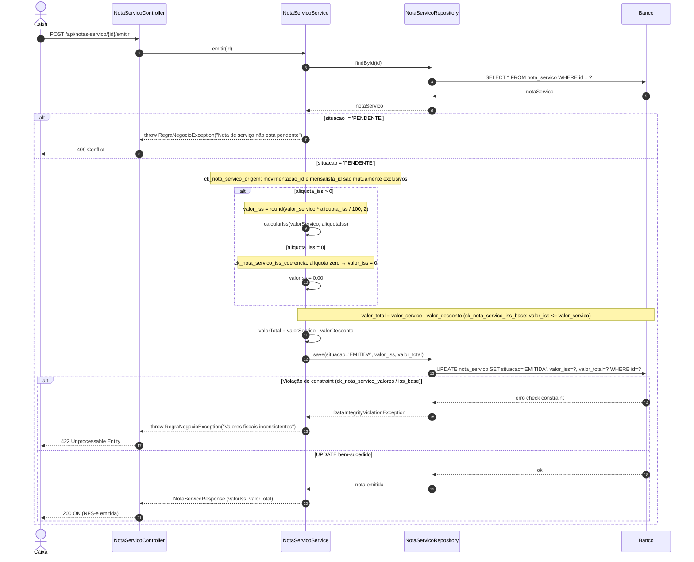

> Links: [[README]] · [[05-casos-de-uso]] · [[08-diagramas-classe]]

# 9. Diagramas de Sequência

## 9.1. Apresentação

Este capítulo descreve, por meio de **Diagramas de Sequência** (notação UML, sintaxe Mermaid `sequenceDiagram`), o comportamento dinâmico do sistema **Estacionamento Kaneko** para os fluxos de negócio mais relevantes. Cada diagrama explicita a colaboração entre os objetos ao longo do tempo, respeitando a arquitetura em camadas prevista para a implementação em **Spring MVC**:

1. **Ator** (Operador / Caixa / Gerente / Administrador) — origina a requisição pela interface.
2. **Controller (REST)** — recebe a requisição HTTP, valida o contrato de entrada (DTO) e delega à camada de serviço.
3. **Service** — concentra as regras de negócio, o controle transacional (`@Transactional`) e a orquestração entre repositórios.
4. **Repository (JPA)** — abstrai o acesso a dados via Spring Data JPA / Hibernate.
5. **Banco** — instância PostgreSQL 17 (`estacionamento_kaneko`), onde residem as restrições de integridade (`CHECK`, `UNIQUE`, índices parciais) definidas em `database/schema.sql`.

A nomenclatura dos artefatos (tabelas, colunas, constraints e índices) referenciados nos diagramas é **idêntica** à do esquema físico, garantindo rastreabilidade direta entre a documentação e o código.

### 9.1.1. Convenções de leitura

- Mensagem de **chamada síncrona**: seta cheia `->>`.
- Mensagem de **retorno**: seta tracejada `-->>`.
- Blocos condicionais e iterativos: `alt` / `else` (escolha exclusiva), `opt` (trecho opcional), `loop` (repetição).
- `Note over X`: observação sobre regra de negócio ou restrição de banco aplicável no ponto.

---

## 9.2. Fluxo 1 — Registrar Entrada de Veículo

Registra o ingresso de um veículo no pátio, criando uma `movimentacao` com `status = 'ABERTO'`. A unicidade de pátio é garantida pelo índice parcial **`uq_mov_veiculo_aberta`**, que impede duas movimentações abertas para o mesmo `veiculo_id`. O serviço executa a checagem antecipada (fail-fast) e ainda assim trata a violação de constraint como salvaguarda de concorrência.

```mermaid
sequenceDiagram
    autonumber
    actor Op as Operador
    participant Ctrl as MovimentacaoController
    participant Svc as MovimentacaoService
    participant Repo as MovimentacaoRepository
    participant DB as Banco

    Op->>Ctrl: POST /api/movimentacoes/entrada (placa, tipo)
    Ctrl->>Svc: registrarEntrada(dto)
    Svc->>Repo: findByVeiculoPlaca(placa)
    Repo->>DB: SELECT veiculo WHERE placa = ?
    DB-->>Repo: veiculo
    Repo-->>Svc: veiculo

    Note over Svc,DB: Checagem antecipada da regra uq_mov_veiculo_aberta
    Svc->>Repo: existsByVeiculoIdAndStatus(veiculoId, 'ABERTO')
    Repo->>DB: SELECT count(*) FROM movimentacao WHERE veiculo_id = ? AND status = 'ABERTO'
    DB-->>Repo: total
    Repo-->>Svc: jaAberta (boolean)

    alt Já existe movimentação ABERTA para o veículo
        Svc-->>Ctrl: throw RegraNegocioException("Veículo já está no pátio")
        Ctrl-->>Op: 409 Conflict
    else Veículo livre para entrada
        alt tipo = MENSALISTA
            Svc->>Repo: findContratoAtivo(veiculoId)
            Repo->>DB: SELECT * FROM mensalista WHERE veiculo_id = ? AND status = 'ATIVO'
            DB-->>Repo: mensalista
            Repo-->>Svc: mensalista
            Note over Svc: tipo='MENSALISTA' exige mensalista_id (ck_mov_tipo_coerencia); tarifa_id permanece nulo
        else tipo = AVULSO
            Svc->>Repo: findTarifaAtiva()
            Repo->>DB: SELECT * FROM tarifa WHERE ativo = TRUE
            DB-->>Repo: tarifa
            Repo-->>Svc: tarifa
            Note over Svc: tipo='AVULSO' não informa mensalista_id; vincula tarifa_id vigente
        end

        Svc->>Repo: save(movimentacao status='ABERTO', data_entrada=now())
        Repo->>DB: INSERT INTO movimentacao (...)
        alt Violação de uq_mov_veiculo_aberta (concorrência)
            DB-->>Repo: erro unique constraint
            Repo-->>Svc: DataIntegrityViolationException
            Svc-->>Ctrl: throw RegraNegocioException("Veículo já está no pátio")
            Ctrl-->>Op: 409 Conflict
        else INSERT bem-sucedido
            DB-->>Repo: id gerado
            Repo-->>Svc: movimentacao persistida
            Svc-->>Ctrl: MovimentacaoResponse
            Ctrl-->>Op: 201 Created (ticket de entrada)
        end
    end
```

---

## 9.3. Fluxo 2 — Registrar Saída e Cálculo de Tarifa

Encerra a movimentação aberta, calcula o `valor_cobrado` e altera o `status` para `'FECHADO'`. O cálculo bifurca por `tipo`: **mensalista** não paga avulso (valor zero); **avulso** paga por horas cheias/fração ao `valor_hora`, com **teto** no `valor_diaria` por diária, e **cortesia** quando a permanência for inferior à `tolerancia_min` da `tarifa`.

```mermaid
sequenceDiagram
    autonumber
    actor Op as Operador
    participant Ctrl as MovimentacaoController
    participant Svc as MovimentacaoService
    participant Repo as MovimentacaoRepository
    participant DB as Banco

    Op->>Ctrl: POST /api/movimentacoes/{id}/saida
    Ctrl->>Svc: registrarSaida(id)
    Svc->>Repo: findById(id)
    Repo->>DB: SELECT * FROM movimentacao WHERE id = ?
    DB-->>Repo: movimentacao
    Repo-->>Svc: movimentacao

    alt status != 'ABERTO'
        Svc-->>Ctrl: throw RegraNegocioException("Movimentação não está aberta")
        Ctrl-->>Op: 409 Conflict
    else status = 'ABERTO'
        Note over Svc: dataSaida = now(); permanência = data_saida - data_entrada (ck_mov_saida: data_saida >= data_entrada)

        alt tipo = MENSALISTA
            Note over Svc: Contrato vigente cobre a estadia → valor_cobrado = 0
            Svc->>Svc: valorCobrado = 0.00
        else tipo = AVULSO
            Svc->>Repo: findTarifaById(tarifaId)
            Repo->>DB: SELECT valor_hora, valor_diaria, tolerancia_min FROM tarifa WHERE id = ?
            DB-->>Repo: tarifa
            Repo-->>Svc: tarifa

            alt minutosPermanencia <= tolerancia_min
                Note over Svc: Cortesia sob tolerância → valor_cobrado = 0
                Svc->>Svc: valorCobrado = 0.00
            else minutosPermanencia > tolerancia_min
                Note over Svc: horas = ceil(minutos / 60); bruto = horas * valor_hora
                Svc->>Svc: bruto = horasCheias * valor_hora
                alt bruto > valor_diaria (aplica teto por diária)
                    Svc->>Svc: valorCobrado = diarias * valor_diaria
                else bruto <= valor_diaria
                    Svc->>Svc: valorCobrado = bruto
                end
            end
        end

        Svc->>Repo: save(status='FECHADO', data_saida, valor_cobrado)
        Repo->>DB: UPDATE movimentacao SET status='FECHADO', data_saida=?, valor_cobrado=? WHERE id=?
        DB-->>Repo: ok
        Repo-->>Svc: movimentacao fechada
        Svc-->>Ctrl: SaidaResponse (valorCobrado)
        Ctrl-->>Op: 200 OK (comprovante de saída)
    end
```

---

## 9.4. Fluxo 3 — Registrar Compra / Nota de Entrada (confirmação)

A `nota_entrada` é cadastrada em situação `'PENDENTE'`. Ao **confirmar**, o sistema soma as quantidades dos itens ao estoque do `produto` e gera as parcelas de `conta_pagar` conforme a `condicao_pagamento`. A operação é transacional: ou tudo é persistido, ou nada.

```mermaid
sequenceDiagram
    autonumber
    actor Op as Operador
    participant Ctrl as NotaEntradaController
    participant Svc as NotaEntradaService
    participant Repo as NotaEntradaRepository
    participant ProdRepo as ProdutoRepository
    participant CPRepo as ContaPagarRepository
    participant DB as Banco

    Op->>Ctrl: POST /api/notas-entrada/{id}/confirmar
    Ctrl->>Svc: confirmar(id)
    Svc->>Repo: findByIdComItens(id)
    Repo->>DB: SELECT nota_entrada + item_nota_entrada WHERE nota_entrada_id = ?
    DB-->>Repo: nota + itens
    Repo-->>Svc: notaEntrada

    alt situacao != 'PENDENTE'
        Svc-->>Ctrl: throw RegraNegocioException("Nota não está pendente")
        Ctrl-->>Op: 409 Conflict
    else situacao = 'PENDENTE'
        Note over Svc,DB: Início da transação (@Transactional)

        loop Para cada item_nota_entrada
            Svc->>ProdRepo: findById(produtoId)
            ProdRepo->>DB: SELECT quantidade FROM produto WHERE id = ?
            DB-->>ProdRepo: produto
            ProdRepo-->>Svc: produto
            Svc->>ProdRepo: save(quantidade += item.quantidade)
            ProdRepo->>DB: UPDATE produto SET quantidade = quantidade + ? WHERE id = ?
            DB-->>ProdRepo: ok
            ProdRepo-->>Svc: produto atualizado
        end

        Svc->>Repo: findCondicao(condicaoPagamentoId)
        Repo->>DB: SELECT * FROM condicao_pagamento + parcela_condicao_pagamento
        DB-->>Repo: condicao + parcelas
        Repo-->>Svc: condicao

        loop Para cada parcela da condição
            Note over Svc: valor_total da parcela = valor_total da nota * percentual; data_vencimento = data_emissao + dias (ck_conta_pagar_vencimento)
            Svc->>CPRepo: save(conta_pagar PENDENTE, numero_parcela, total_parcelas)
            CPRepo->>DB: INSERT INTO conta_pagar (... uq_conta_pagar_parcela)
            DB-->>CPRepo: id gerado
            CPRepo-->>Svc: parcela gerada
        end

        Svc->>Repo: save(situacao='CONFIRMADA')
        Repo->>DB: UPDATE nota_entrada SET situacao='CONFIRMADA' WHERE id=?
        DB-->>Repo: ok
        Repo-->>Svc: nota confirmada
        Note over Svc,DB: Commit da transação
        Svc-->>Ctrl: NotaEntradaResponse
        Ctrl-->>Op: 200 OK (estoque somado + contas a pagar geradas)
    end
```

---

## 9.5. Fluxo 4 — Registrar Venda / Nota de Saída (confirmação)

A `nota_saida` é cadastrada em `'PENDENTE'`. Ao **confirmar**, o sistema valida saldo de estoque de cada `produto`, baixa as quantidades vendidas e gera as parcelas de `conta_receber` conforme a `condicao_pagamento`. Estoque insuficiente aborta toda a transação.

```mermaid
sequenceDiagram
    autonumber
    actor Cx as Caixa
    participant Ctrl as NotaSaidaController
    participant Svc as NotaSaidaService
    participant Repo as NotaSaidaRepository
    participant ProdRepo as ProdutoRepository
    participant CRRepo as ContaReceberRepository
    participant DB as Banco

    Cx->>Ctrl: POST /api/notas-saida/{id}/confirmar
    Ctrl->>Svc: confirmar(id)
    Svc->>Repo: findByIdComItens(id)
    Repo->>DB: SELECT nota_saida + item_nota_saida WHERE nota_saida_id = ?
    DB-->>Repo: nota + itens
    Repo-->>Svc: notaSaida

    alt situacao != 'PENDENTE'
        Svc-->>Ctrl: throw RegraNegocioException("Nota não está pendente")
        Ctrl-->>Cx: 409 Conflict
    else situacao = 'PENDENTE'
        Note over Svc,DB: Início da transação (@Transactional)

        loop Para cada item_nota_saida (validação de estoque)
            Svc->>ProdRepo: findById(produtoId)
            ProdRepo->>DB: SELECT quantidade FROM produto WHERE id = ?
            DB-->>ProdRepo: produto
            ProdRepo-->>Svc: produto
            alt produto.quantidade < item.quantidade
                Note over Svc: ck_produto_valores impede quantidade negativa
                Svc-->>Ctrl: throw RegraNegocioException("Estoque insuficiente: " + produto.nome)
                Ctrl-->>Cx: 422 Unprocessable Entity
            else estoque suficiente
                Note over Svc: validação aprovada para o item
            end
        end

        loop Para cada item_nota_saida (baixa de estoque)
            Svc->>ProdRepo: save(quantidade -= item.quantidade)
            ProdRepo->>DB: UPDATE produto SET quantidade = quantidade - ? WHERE id = ?
            DB-->>ProdRepo: ok
            ProdRepo-->>Svc: produto atualizado
        end

        Svc->>Repo: findCondicao(condicaoPagamentoId)
        Repo->>DB: SELECT * FROM condicao_pagamento + parcela_condicao_pagamento
        DB-->>Repo: condicao + parcelas
        Repo-->>Svc: condicao

        loop Para cada parcela da condição
            Note over Svc: conta_receber PENDENTE; valor_total da parcela; uq_conta_receber_parcela (nota_saida_id, numero_parcela)
            Svc->>CRRepo: save(conta_receber PENDENTE)
            CRRepo->>DB: INSERT INTO conta_receber (...)
            DB-->>CRRepo: id gerado
            CRRepo-->>Svc: parcela gerada
        end

        Svc->>Repo: save(situacao='CONFIRMADA')
        Repo->>DB: UPDATE nota_saida SET situacao='CONFIRMADA' WHERE id=?
        DB-->>Repo: ok
        Repo-->>Svc: nota confirmada
        Note over Svc,DB: Commit da transação
        Svc-->>Ctrl: NotaSaidaResponse
        Ctrl-->>Cx: 200 OK (estoque baixado + contas a receber geradas)
    end
```

---

## 9.6. Fluxo 5 — Emitir Nota de Serviço (cálculo de ISS)

A `nota_servico` documenta o serviço prestado (estacionamento avulso, mensalidade ou lavagem), com origem opcional em `movimentacao` **ou** `mensalista` (nunca ambas — `ck_nota_servico_origem`). Na emissão, calcula-se o `valor_iss` a partir da `aliquota_iss` sobre o `valor_servico` e a situação passa de `'PENDENTE'` para `'EMITIDA'`.



---

## 9.7. Fluxo 6 — Baixar Conta a Receber (PENDENTE → PARCIAL → RECEBIDA)

Registra o recebimento (total ou parcial) de uma parcela de `conta_receber`. O `valor_recebido` é acumulado e a `situacao` evolui de `'PENDENTE'` para `'PARCIAL'` (quando ainda há saldo) ou para `'RECEBIDA'` (quando quitada), respeitando `ck_conta_receber_recebido_teto` e `ck_conta_receber_baixa`.

```mermaid
sequenceDiagram
    autonumber
    actor Cx as Caixa
    participant Ctrl as ContaReceberController
    participant Svc as ContaReceberService
    participant Repo as ContaReceberRepository
    participant DB as Banco

    Cx->>Ctrl: POST /api/contas-receber/{id}/baixar (valorRecebido, dataRecebimento)
    Ctrl->>Svc: baixar(id, valorRecebido, dataRecebimento)
    Svc->>Repo: findById(id)
    Repo->>DB: SELECT valor_total, valor_recebido, situacao FROM conta_receber WHERE id = ?
    DB-->>Repo: contaReceber
    Repo-->>Svc: contaReceber

    alt situacao IN ('RECEBIDA','CANCELADA')
        Svc-->>Ctrl: throw RegraNegocioException("Conta já liquidada ou cancelada")
        Ctrl-->>Cx: 409 Conflict
    else situacao IN ('PENDENTE','PARCIAL')
        Note over Svc: novoRecebido = valor_recebido + valorRecebido
        alt novoRecebido > valor_total
            Note over Svc: ck_conta_receber_recebido_teto: valor_recebido <= valor_total
            Svc-->>Ctrl: throw RegraNegocioException("Valor excede o saldo da parcela")
            Ctrl-->>Cx: 422 Unprocessable Entity
        else novoRecebido <= valor_total
            alt novoRecebido = valor_total (quitação total)
                Note over Svc: situacao='RECEBIDA' exige data_recebimento (ck_conta_receber_baixa)
                Svc->>Svc: situacao = 'RECEBIDA'; dataRecebimento preenchida
            else novoRecebido < valor_total (recebimento parcial)
                Note over Svc: situacao='PARCIAL'; data_recebimento permanece nula
                Svc->>Svc: situacao = 'PARCIAL'
            end

            Svc->>Repo: save(valor_recebido, situacao, data_recebimento)
            Repo->>DB: UPDATE conta_receber SET valor_recebido=?, situacao=?, data_recebimento=? WHERE id=?
            DB-->>Repo: ok
            Repo-->>Svc: contaReceber atualizada
            Svc-->>Ctrl: ContaReceberResponse (situacao, saldo)
            Ctrl-->>Cx: 200 OK (baixa registrada)
        end
    end
```

---

## 9.8. Fluxo 7 — Cadastro Genérico com Exclusão Lógica

Representa o padrão comum a todos os cadastros de apoio (`cliente`, `fornecedor`, `produto`, `tarifa`, `categoria`, `marca`, `transportadora`, `veiculo_frota`, etc.), que herdam o atributo `ativo BOOLEAN`. A exclusão **nunca** remove o registro fisicamente: realiza-se *soft delete* via `ativo = FALSE`, preservando a integridade referencial (`ON DELETE RESTRICT`) e o histórico. O diagrama ilustra cadastro/atualização e a exclusão lógica. Os cadastros do **Módulo de Logística** — `transportadora` e `veiculo_frota` — bem como o vínculo N:N `transportadora_veiculo_frota` (a frota) seguem exatamente este mesmo fluxo genérico, com chave natural única `uq_transportadora_documento`, `uq_veiculo_frota_placa` e `uq_transp_veiculo_frota`, respectivamente.

```mermaid
sequenceDiagram
    autonumber
    actor Op as Operador
    participant Ctrl as CadastroController
    participant Svc as CadastroService
    participant Repo as CadastroRepository
    participant DB as Banco

    Note over Op,DB: Padrão genérico para entidades com coluna "ativo" (ex.: cliente, fornecedor, produto, tarifa)

    Op->>Ctrl: POST /api/{entidade} (dados do cadastro)
    Ctrl->>Svc: salvar(dto)
    Svc->>Repo: existsByChaveNatural(documento/placa/nome)
    Repo->>DB: SELECT count(*) WHERE chave_natural = ?
    DB-->>Repo: total
    Repo-->>Svc: existe (boolean)

    alt Já existe registro com a mesma chave natural única
        Note over Svc: Restrição UNIQUE (ex.: uq_cliente_documento, uq_veiculo_placa)
        Svc-->>Ctrl: throw RegraNegocioException("Registro já cadastrado")
        Ctrl-->>Op: 409 Conflict
    else Chave natural disponível
        Svc->>Repo: save(entidade, ativo=TRUE)
        Repo->>DB: INSERT INTO {entidade} (..., ativo) VALUES (..., TRUE)
        DB-->>Repo: id gerado
        Repo-->>Svc: entidade persistida
        Svc-->>Ctrl: EntidadeResponse
        Ctrl-->>Op: 201 Created
    end

    Note over Op,DB: --- Exclusão lógica (soft delete) ---

    Op->>Ctrl: DELETE /api/{entidade}/{id}
    Ctrl->>Svc: inativar(id)
    Svc->>Repo: findById(id)
    Repo->>DB: SELECT * FROM {entidade} WHERE id = ?
    DB-->>Repo: entidade
    Repo-->>Svc: entidade

    alt Registro não encontrado
        Svc-->>Ctrl: throw RecursoNaoEncontradoException
        Ctrl-->>Op: 404 Not Found
    else Registro encontrado
        opt entidade já está inativa
            Note over Svc: Operação idempotente — nada a fazer
        end
        Svc->>Repo: save(ativo=FALSE)
        Repo->>DB: UPDATE {entidade} SET ativo=FALSE, updated_at=now() WHERE id=?
        DB-->>Repo: ok
        Repo-->>Svc: entidade inativada
        Note over Svc,DB: Registro preservado; consultas padrão filtram ativo = TRUE
        Svc-->>Ctrl: void
        Ctrl-->>Op: 204 No Content
    end
```

---

## 9.9. Considerações Finais

Os sete diagramas acima cobrem os fluxos críticos do sistema e servem de contrato comportamental para a implementação Spring MVC. Observam-se três princípios transversais:

1. **Defesa em profundidade** — as regras de negócio são verificadas na camada `Service` (fail-fast) e reforçadas pelas restrições do banco (`CHECK`, `UNIQUE`, índices parciais como `uq_mov_veiculo_aberta`, `uq_mensalista_veiculo_ativo`, `uq_conta_receber_parcela`), tratando-se as violações de integridade como salvaguarda de concorrência.
2. **Transacionalidade** — operações que afetam múltiplas tabelas (confirmação de notas, geração de parcelas, baixa de estoque) ocorrem sob `@Transactional`, garantindo atomicidade.
3. **Preservação de histórico** — a exclusão é sempre lógica (`ativo = FALSE`), em coerência com as políticas `ON DELETE RESTRICT` do esquema físico.

Estes diagramas devem ser mantidos sincronizados com os [[05-casos-de-uso]] (origem dos fluxos) e com os [[08-diagramas-classe]] (estrutura estática das classes de domínio e serviço).
