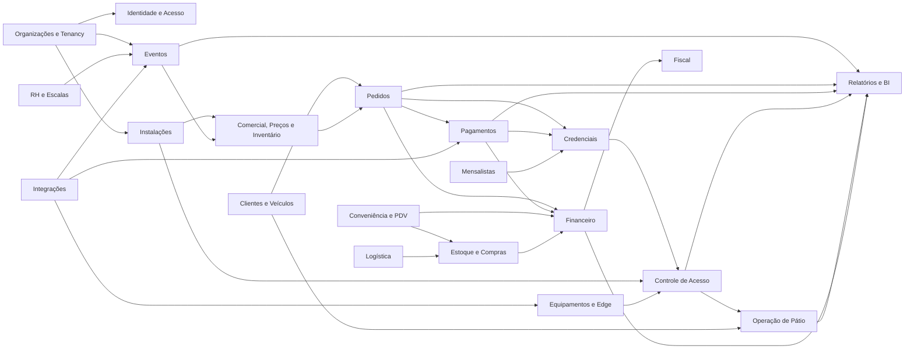

> Links: [[README]] · [[11-visao-produto-enterprise]] · [[13-event-storming]] · [[14-modelagem-dominio]]

# 12. Domínio e Context Map (DDD)

## 12.1 Estado atual e direção

O código atual é um monólito organizado por funcionalidade (`geografia`, `pessoas`, `fornecedor`, `rh`, `usuario`, `patio`, `pagamento`, `conveniencia`, `fiscal`, `financeiro`, `logistica`, `relatorio` e `common`). Essa organização é uma boa base física, mas ainda não representa bounded contexts independentes: services acessam repositories de outros pacotes, entidades JPA são compartilhadas e não existem portas, anti-corruption layers ou eventos de domínio explícitos.

A arquitetura-alvo preserva o monólito modular, introduz fronteiras de domínio. Cada contexto é proprietário de seus dados e publica contratos; referências externas ao contexto são feitas por identificadores e snapshots, não por grafos ORM compartilhados.

## 12.2 Linguagem ubíqua

| Termo | Definição normativa |
|---|---|
| Organização | Tenant proprietário de dados, usuários, pátios, eventos e transações. |
| Venue | Local que recebe eventos e pode possuir ou contratar pátios. |
| Pátio | Instalação física controlada para estacionamento. |
| Setor | Divisão operacional de um pátio. |
| Vaga | Unidade física opcionalmente individualizada dentro de um setor. |
| Capacidade física | Limite estrutural de veículos. |
| Capacidade operacional | Limite liberado para uso após bloqueios e segurança. |
| Capacidade vendável | Parcela que pode ser comprometida comercialmente. |
| Alocação | Compromisso temporal de capacidade de um pátio para evento/modalidade. |
| Inventário | Quantidade comercial controlada por produto, canal, lote e período. |
| Reserva de inventário | Bloqueio temporário antes da confirmação de uma compra. |
| Pedido | Contrato comercial entre comprador e organização. |
| Pagamento | Processo transacional de autorização, captura, liquidação ou restituição. |
| Credencial | Direito de acesso materializado por token, QR, placa, RFID ou outro meio. |
| Check-in | Consumo/autorização de entrada de uma credencial. |
| Presença | Estado de uma credencial/veículo dentro da área controlada. |
| Movimentação | Permanência física de um veículo, da entrada à saída. |
| Evento | Ocorrência temporal comercial e operacional que demanda estacionamento. |
| Produto de estacionamento | Oferta vendável que define direito, pátio, categoria e condições. |
| Lote de preço | Regra temporal ou quantitativa que determina preço de venda. |

## 12.3 Context Map

## 12.4 Regras de relacionamento entre contextos

1. `Organizacoes` é upstream para todos os contextos empresariais.
2. `Instalacoes` descreve topologia física; não controla venda ou ocupação.
3. `Eventos` controla agenda e operação; não vende diretamente.
4. `ComercialInventario` transforma capacidade em oferta e é a única autoridade sobre disponibilidade comercial.
5. `Pedidos` captura preço e condições como snapshot; não recalcula pedidos confirmados.
6. `Pagamentos` não altera pedido por acesso direto ao banco; publica resultado.
7. `Credenciais` materializa direitos originados por pedido, cortesia ou contrato.
8. `ControleAcesso` decide tentativas; `OperacaoPatio` registra permanência.
9. `Financeiro` reconhece títulos, baixas, repasses e conciliação; não reinterpreta o pedido.
10. `RelatoriosBI` é downstream e somente leitura.
11. Sistemas externos entram exclusivamente pelo contexto `Integracoes` e suas ACLs.

## 12.5 Catálogo de bounded contexts

### BC01 — Organizações e Tenancy

**Situação implementada:** `Organizacao` e `UnidadeOperacional` do tipo `VENUE`
estão persistidas no tenant ativo. Outros tipos de unidade, contatos e branding
permanecem dependentes de contrato próprio.

- **Objetivo:** definir propriedade, configuração e isolamento dos dados.
- **Responsabilidades:** organização, unidades, branding, fuso, moeda, plano, status e políticas regionais.
- **Agregado raiz:** `Organizacao`.
- **Entidades:** `Organizacao`, `UnidadeOperacional`.
- **Value Objects:** `DocumentoEmpresarial`, `Endereco`, `Contato`, `FusoHorario`, `Moeda`.
- **Serviços de domínio:** `PoliticaDeProvisionamento`, `PoliticaDeAtivacao`.
- **Invariantes:** organização imutável como proprietária; inativa não inicia operações; fuso e moeda obrigatórios; unicidades respeitam tenant.
- **Eventos:** `OrganizacaoCriada`, `OrganizacaoAtivada`, `OrganizacaoSuspensa`, `UnidadeCriada`, `ConfiguracaoAlterada`.
- **Dependências:** dados geográficos; downstream de nenhum contexto empresarial.

### BC02 — Identidade, Acesso e Auditoria

- **Objetivo:** autenticar identidades e autorizar ações por permissão e escopo.
- **Agregados:** `Usuario`, `MembroOrganizacao`, `Papel`, `AtribuicaoAcesso`.
- **Entidades:** `Sessao`, `Permissao`, `Escopo`, `ConviteUsuario`, `RegistroAuditoria`.
- **Value Objects:** `Identidade`, `HashSenha`, `EscopoAcesso`, `ConjuntoPermissoes`.
- **Serviços:** `Autorizador`, `ResolvedorPermissoes`, `RegistradorAuditoria`.
- **Invariantes:** usuário é identidade global; no máximo uma Membership corrente por usuário/organização; contexto autenticado exige organização e Membership ativas na mesma versão do token; escopo pertencente ao tenant; permissão efetiva é interseção entre papel, escopo, vigência e estado; auditoria não editável.
- **Eventos:** `UsuarioConvidado`, `UsuarioAtivado`, `PapelAtribuido`, `AcessoRevogado`, `LoginRealizado`, `OperacaoSensivelAuditada`.
- **Dependências:** `Organizacoes`; fornece autorização para todos.

### BC03 — Cadastros Mestres: Pessoas, Clientes e Veículos

- **Objetivo:** manter identidades comerciais e veículos sem absorver contratos ou sessões.
- **Agregados:** `Cliente`, `Fornecedor`, `Veiculo`.
- **Entidades:** contatos e vínculos temporais cliente-veículo.
- **Value Objects:** `CPF`, `CNPJ`, `Email`, `Telefone`, `Placa`, `Renavam`, `Endereco`.
- **Serviços:** `NormalizadorPlaca`, `PoliticaVinculoVeiculo`.
- **Invariantes:** documentos e placas normalizados; histórico de alteração; veículo inativo não inicia sessão; vínculos possuem vigência.
- **Eventos:** `ClienteCadastrado`, `FornecedorCadastrado`, `VeiculoCadastrado`, `VeiculoVinculado`, `VeiculoBloqueado`.
- **Dependências:** `Organizacoes`, dados geográficos.

### BC04 — Instalações e Capacidade Física

**Situação implementada:** a raiz `Patio` e o comando `PatioCriado` estão
implementados para organização ativa. Setor, vaga, faixa, interdição e alteração
de capacidade permanecem nas histórias próprias.

- **Objetivo:** descrever pátio, setor, vaga, faixa e limites físicos.
- **Agregados:** `Patio`, `Setor`, `Vaga` — separados para evitar coleções gigantes.
- **Entidades:** `FaixaAcesso`, `Interdicao`, `RegraOperacionalLocal`.
- **Value Objects:** `Capacidade`, `Coordenada`, `PeriodoInterdicao`, `CategoriaVeiculo`.
- **Serviços:** `CalculadorCapacidadeOperacional`, `ValidadorConflitoFisico`.
- **Invariantes:** operacional ≤ física; setor pertence a um pátio; vaga pertence a um setor; pátio inativo não recebe nova alocação.
- **Eventos:** `PatioCriado`, `SetorCriado`, `VagaCriada`, `CapacidadeAlterada`, `PatioInterditado`.
- **Dependências:** `Organizacoes`, `CadastrosMestres` para localização.

### BC05 — Gestão de Eventos

**Situação implementada:** a criação do agregado `Evento` está disponível em
`RASCUNHO`, com ownership direto, venue visível, período/fuso, versão,
idempotência, auditoria e `EventoCriado` persistido em outbox. A alocação
temporal multipátio já é implementada no BC06; configuração, publicação e
demais transições permanecem nas histórias seguintes.

- **Objetivo:** controlar identidade, agenda, participantes, políticas e ciclo operacional do evento.
- **Agregado:** `Evento`.
- **Entidades:** `JanelaOperacional`, `ParticipanteOrganizacional`, `PortaoLogico`, `PoliticaEvento`.
- **Value Objects:** `Periodo`, `PoliticaReentrada`, `PoliticaCancelamento`, `JanelaAcesso`.
- **Serviços:** `PublicadorEvento`, `ValidadorProntidaoEvento`.
- **Invariantes:** datas coerentes; publicação requer responsável, local, alocação e produto; alteração material após publicação exige versão/comunicação; finalização exige operação encerrada.
- **Eventos:** `EventoCriado`, `EventoConfigurado`, `EventoPublicado`, `VendasAbertas`, `OperacaoIniciada`, `EventoCancelado`, `EventoFinalizado`.
- **Dependências:** `Organizacoes`, `Instalacoes`, `RHEscalas`.

### BC06 — Comercial, Preços e Inventário

**Situação implementada:** `AlocacaoPatioEvento` compromete capacidade
operacional, vendável e reservada de um pátio ativo para uma janela do evento.
O saldo simultâneo é protegido por lock pessimista no pátio, validação
transacional e constraints tenant-aware. Produtos, lotes, reserva de inventário
e projeções de disponibilidade permanecem TARGET.

- **Objetivo:** transformar capacidade em ofertas sem sobrevenda.
- **Agregados:** `AlocacaoCapacidade`, `ProdutoEstacionamento`, `PoliticaPreco`, `ReservaInventario`.
- **Entidades:** `LotePreco`, `QuotaCanal`, `QuotaEspecial`, `RestricaoProduto`.
- **Value Objects:** `Dinheiro`, `Quantidade`, `CanalVenda`, `PeriodoVenda`, `SnapshotPreco`.
- **Serviços:** `Disponibilidade`, `SelecionadorPreco`, `PoliticaCortesia`.
- **Invariantes:** `vendido + reservado + bloqueado ≤ vendável`; vendável + reserva operacional ≤ operacional; reserva expira; preço é congelado; última vaga é protegida atomicamente.
- **Eventos:** `CapacidadeAlocada`, `ProdutoPublicado`, `InventarioReservado`, `ReservaExpirada`, `InventarioConfirmado`, `InventarioLiberado`, `EventoEsgotado`.
- **Dependências:** `Eventos`, `Instalacoes`, `Organizacoes`.

### BC07 — Pedidos

- **Objetivo:** representar intenção e contrato comercial com o comprador.
- **Agregado:** `Pedido`.
- **Entidades:** `ItemPedido`, `Desconto`, `Comprador`, `OrigemPedido`.
- **Value Objects:** `TotalPedido`, `SnapshotProduto`, `ChaveIdempotencia`.
- **Serviços:** `CalculadorTotal`, `PoliticaCancelamentoPedido`.
- **Invariantes:** item exige reserva válida; total derivado; pedido pago é imutável; cancelamento não devolve capacidade duas vezes; idempotência não cria duplicidade.
- **Eventos:** `PedidoCriado`, `PedidoAguardandoPagamento`, `PedidoConfirmado`, `PedidoCancelado`, `PedidoExpirado`, `PedidoAtendido`.
- **Dependências:** `Inventario`, `CadastrosMestres`; upstream de `Pagamentos` e `Credenciais`.

### BC08 — Pagamentos Transacionais

- **Objetivo:** controlar autorização, captura, liquidação, reembolso e chargeback.
- **Agregados:** `IntencaoPagamento`, `Reembolso`.
- **Entidades:** `TentativaPagamento`, `Transacao`, `Captura`, `Estorno`.
- **Value Objects:** `Dinheiro`, `MetodoPagamento`, `TokenExterno`, `ReferenciaGateway`.
- **Serviços:** `OrquestradorPagamento`, `PoliticaReembolso`, `ConciliadorGateway`.
- **Invariantes:** sem dados sensíveis de cartão; referência externa única; captura ≤ autorização; reembolso ≤ captura; webhook duplicado sem efeito duplicado.
- **Eventos:** `PagamentoIniciado`, `PagamentoAprovado`, `PagamentoRecusado`, `PagamentoCapturado`, `PagamentoReembolsado`, `ChargebackRecebido`, `PagamentoDivergente`.
- **Dependências:** `Pedidos`, ACL de gateways; fornece fatos ao `Financeiro`.

### BC09 — Credenciais

- **Objetivo:** materializar o direito de acesso sem depender do meio físico.
- **Agregado:** `CredencialAcesso`.
- **Entidades:** `RepresentacaoQR`, `PlacaAutorizada`, `TagRFID`, `SubstituicaoCredencial`.
- **Value Objects:** `TokenOpaco`, `HashToken`, `DireitoAcesso`, `PeriodoValidade`, `PoliticaUso`.
- **Serviços:** `EmissorCredencial`, `ValidadorDireito`, `GeradorRepresentacao`.
- **Invariantes:** origem válida; token imprevisível; reemissão revoga anterior; escopo de evento/pátio/período; consumo único atômico; reentrada conforme política.
- **Eventos:** `CredencialSolicitada`, `CredencialEmitida`, `QRCodeGerado`, `CredencialBloqueada`, `CredencialSubstituida`, `CredencialConsumida`.
- **Dependências:** `Pedidos`, `Pagamentos`, `Mensalistas`.

### BC10 — Controle de Acesso

- **Objetivo:** decidir e registrar tentativas de entrada e saída.
- **Agregados:** `TentativaAcesso`, `Presenca`.
- **Entidades:** `OverrideAcesso`, `EvidenciaAcesso`.
- **Value Objects:** `Portao`, `Direcao`, `Decisao`, `Motivo`, `InstanteDispositivo`.
- **Serviços:** `PoliticaAutorizacaoAcesso`, `ResolvedorDuplicidade`, `SincronizadorOffline`.
- **Invariantes:** toda tentativa é registrada; decisão valida tenant, evento, janela, pátio, credencial e veículo; override exige permissão e motivo; conflitos offline não são descartados.
- **Eventos:** `AcessoSolicitado`, `AcessoAutorizado`, `AcessoRecusado`, `CheckinRealizado`, `CheckoutRealizado`, `ConflitoCheckinDetectado`.
- **Dependências:** `Credenciais`, `Instalacoes`, `Equipamentos`.

### BC11 — Operação de Pátio

- **Objetivo:** controlar permanência, ocupação e fluxo físico.
- **Agregado:** `SessaoEstacionamento` (evolução semântica de `Movimentacao`).
- **Entidades:** `AjusteOperacional`, `DirecionamentoSetor`.
- **Value Objects:** `OrigemDireito`, `SnapshotVeiculo`, `Permanencia`.
- **Serviços:** `PoliticaEntrada`, `PoliticaSaida`, `CalculadoraTarifaRotativa`.
- **Invariantes:** uma sessão incompatível aberta por veículo; entrada autorizada; encerrada não reabre; ocupação é projeção; evento/pedido/credencial preservados quando aplicáveis.
- **Eventos:** `MovimentacaoAberta`, `VeiculoDirecionado`, `MovimentacaoEncerrada`, `MovimentacaoCancelada`, `OcupacaoAlterada`, `PatioLotado`.
- **Dependências:** `ControleAcesso`, `CadastrosMestres`, futuramente `PrecosRotativos`.

### BC12 — Mensalistas

- **Objetivo:** controlar planos, contratos, direitos recorrentes e cobranças.
- **Agregados:** `PlanoAssinatura`, `ContratoMensalista`.
- **Entidades:** `VeiculoAutorizado`, `Vigencia`, `CobrancaRecorrente`.
- **Value Objects:** `Competencia`, `LimiteSimultaneidade`, `RegraInadimplencia`.
- **Serviços:** `RenovadorContrato`, `ConcessorDireitoRecorrente`.
- **Invariantes:** vigência válida; limite de veículos; acesso depende do estado e inadimplência; cancelamento preserva histórico.
- **Eventos:** `ContratoCriado`, `ContratoAtivado`, `MensalidadeGerada`, `ContratoSuspenso`, `ContratoRenovado`, `ContratoCancelado`.
- **Dependências:** `CadastrosMestres`, `Pagamentos`, `Financeiro`, `Credenciais`.

### BC13 — Conveniência e PDV

- **Objetivo:** vender produtos e serviços no balcão/evento.
- **Agregados:** `VendaPDV`, `Comanda`, `SessaoCaixa`.
- **Entidades:** `ItemVenda`, `RecebimentoPDV`, `Sangria`, `Suprimento`.
- **Value Objects:** `Dinheiro`, `Quantidade`, `SnapshotItem`.
- **Serviços:** `CalculadorVenda`, `FechadorCaixa`.
- **Invariantes:** caixa aberto; total derivado; cancelamento compensatório; operador não aprova divergência própria acima do limite.
- **Eventos:** `CaixaAberto`, `VendaPDVRealizada`, `VendaPDVCancelada`, `SangriaRegistrada`, `CaixaFechado`.
- **Dependências:** `EstoqueCompras`, `Pagamentos`, `Financeiro`.

### BC14 — Estoque e Compras

- **Objetivo:** controlar catálogo, fornecedores, compras e razão de estoque.
- **Agregados:** `Produto`, `Compra`, `MovimentoEstoque`.
- **Entidades:** `ItemCompra`, `LocalEstoque`, `LoteEstoque`, `ProdutoFornecedor`.
- **Value Objects:** `Quantidade`, `Custo`, `UnidadeMedida`.
- **Serviços:** `AvaliadorEstoque`, `RateadorCusto`.
- **Invariantes:** estoque altera somente por movimento; saldo não negativo salvo política; cancelamento cria compensação; custo e origem auditáveis.
- **Eventos:** `ProdutoCadastrado`, `CompraConfirmada`, `EstoqueRecebido`, `EstoqueBaixado`, `EstoqueAjustado`, `EstoqueMinimoAtingido`.
- **Dependências:** `CadastrosMestres`, `Logistica`; fornece fatos para `Financeiro`/`Fiscal`.

### BC15 — Financeiro

- **Objetivo:** reconhecer, liquidar e conciliar direitos e obrigações.
- **Agregados:** `ContaReceber`, `ContaPagar`, `Conciliacao`, `Repasse`, `CentroCusto`.
- **Entidades:** `Baixa`, `Parcela`, `Divergencia`, `RegraRepasse`.
- **Value Objects:** `Dinheiro`, `Competencia`, `Vencimento`, `Saldo`.
- **Serviços:** `LiquidadorTitulo`, `Conciliador`, `CalculadorRepasse`, `GeradorDRE`.
- **Invariantes:** baixa ≤ saldo; liquidada não recebe baixa; estorno compensatório; divergências impedem conciliação automática; regra de repasse versionada.
- **Eventos:** `ContaGerada`, `BaixaRegistrada`, `ContaLiquidada`, `ConciliacaoRealizada`, `DivergenciaDetectada`, `RepasseCalculado`, `DREGerada`.
- **Dependências:** `Pedidos`, `Pagamentos`, `PDV`, `EstoqueCompras`, `Mensalistas`.

### BC16 — Fiscal

- **Objetivo:** determinar obrigação e controlar documentos fiscais internos/externos.
- **Agregados:** `DocumentoFiscal`, preservando `NotaEntrada`, `NotaSaida` e `NotaServico` atuais.
- **Entidades:** `ItemFiscal`, `TentativaTransmissao`, `EventoFiscal`.
- **Value Objects:** `ChaveFiscal`, `NumeroSerie`, `Tributos`, `AmbienteFiscal`.
- **Serviços:** `DeterminadorObrigacaoFiscal`, `EmissorFiscal`, `CanceladorFiscal`.
- **Invariantes:** autorizado não é editado; cancelamento exige prazo/motivo; rejeição não é autorização; numeração e emitente consistentes.
- **Eventos:** `EmissaoFiscalSolicitada`, `DocumentoAutorizado`, `DocumentoRejeitado`, `DocumentoCancelado`.
- **Dependências:** `Financeiro`, ACL dos provedores fiscais.

### BC17 — RH e Escalas

- **Objetivo:** manter vínculo laboral e alocação operacional.
- **Agregados:** `Funcionario`, `EscalaOperacional`.
- **Entidades:** `Cargo`, `Turno`, `AlocacaoEquipe`, `Qualificacao`.
- **Value Objects:** `PeriodoTurno`, `FuncaoOperacional`.
- **Serviços:** `ValidadorConflitoEscala`, `DimensionadorEquipe`.
- **Invariantes:** funcionário ativo/qualificado; turnos não se sobrepõem; alteração após início auditada.
- **Eventos:** `FuncionarioCadastrado`, `EscalaPublicada`, `ColaboradorAlocado`, `TurnoIniciado`, `TurnoEncerrado`.
- **Dependências:** `Organizacoes`, `Eventos`, `IdentidadeAcesso`.

### BC18 — Logística

- **Objetivo:** controlar transportadoras, frota e abastecimento.
- **Agregados:** `Transportadora`, `VeiculoFrota`, `Entrega`.
- **Value Objects:** `PlacaFrota`, `CapacidadeCarga`, `JanelaEntrega`.
- **Serviços:** `PlanejadorEntrega`.
- **Invariantes:** frota ativa e compatível; janela autorizada; placa única no tenant.
- **Eventos:** `TransportadoraCadastrada`, `VeiculoFrotaVinculado`, `EntregaAgendada`, `EntregaRecebida`.
- **Dependências:** `CadastrosMestres`, `EstoqueCompras`.

### BC19 — Equipamentos e Edge

- **Objetivo:** integrar e operar dispositivos sem acoplar fabricantes ao domínio.
- **Agregados:** `Equipamento`, `ComandoEquipamento`, `SiteController`.
- **Entidades:** `InstalacaoEquipamento`, `Telemetria`, `Firmware`, `PoliticaOffline`.
- **Value Objects:** `CapacidadeDispositivo`, `EstadoFisico`, `PrazoComando`.
- **Serviços:** `OrquestradorDispositivos`, `SupervisorSaude`, `DistribuidorPoliticaOffline`.
- **Invariantes:** comando compatível, idempotente, temporal e auditado; enviado ≠ executado; edge opera somente política válida.
- **Eventos:** `EquipamentoOnline`, `EquipamentoOffline`, `PlacaReconhecida`, `CredencialLida`, `BarreiraAberta`, `ComandoFalhou`.
- **Dependências:** `Instalacoes`, adapters externos; fornece fatos a `ControleAcesso`.

### BC20 — Integrações

- **Objetivo:** proteger o domínio de gateways, ticketing, fiscal, mapas e parceiros.
- **Agregados técnicos:** `ConexaoIntegracao`, `EntregaWebhook`, `MensagemInbox`.
- **Value Objects:** `ExternalId`, `AssinaturaWebhook`, `PoliticaRetry`.
- **Serviços:** `AntiCorruptionLayer`, `DespachanteOutbox`, `VerificadorWebhook`, `ReconciliadorExterno`.
- **Invariantes:** assinatura/timestamp validados; external ID único por parceiro/tenant; segredo nunca logado; falha permanente em quarentena.
- **Eventos:** `WebhookRecebido`, `IntegracaoProcessada`, `IntegracaoFalhou`, `EntregaReagendada`, `IntegracaoConciliada`.
- **Dependências:** contratos publicados de todos os contextos; nenhum payload externo vira entidade diretamente.

### BC21 — Relatórios, BI e Auditoria Analítica

- **Objetivo:** produzir projeções operacionais, históricas e financeiras.
- **Modelos de leitura:** ocupação, funil, no-show, pico, receita/vaga, recusas, performance, conciliação, DRE e dispositivos.
- **Serviços:** projetores, agregadores e catálogo de métricas.
- **Invariantes:** somente leitura; indicador possui definição, owner, origem e versão; atraso de projeção é visível.
- **Eventos consumidos:** todos os eventos publicados relevantes.
- **Dependências:** downstream de todos; nunca executa comandos no domínio de origem.

## 12.6 Padrões de consistência

- Uma transação ACID altera um agregado; exceções devem estar documentadas pela invariante protegida.
- `Outbox` grava fatos no mesmo commit da mudança.
- `Inbox` deduplica mensagens recebidas.
- Process managers coordenam compra, cancelamento, check-in, fechamento e sincronização offline.
- Eventos são imutáveis, versionados e nomeados no passado.
- Consultas de dashboard usam projeções; não percorrem agregados transacionais.
- Falhas externas não mantêm transações de banco abertas.

## 12.7 Problemas arquiteturais atuais a resolver

1. `patio` concentra instalação, operação, tarifa, mensalista e colaborador.
2. `MovimentacaoService` decide mensalista, tarifa, entrada, saída e persistência.
3. Pátio é opcional e capacidade não bloqueia entrada.
4. Ocupação física é confundida com disponibilidade comercial.
5. `pagamento` atual contém cadastros, não pagamentos transacionais.
6. `Usuario`, `Funcionario` e `Colaborador` são identidades sobrepostas sem vínculo coerente.
7. Relatórios sincrônicos consultam vários repositórios e não servem ao pico de eventos.
8. Não existem tenant, domain events, outbox, inbox ou idempotência.
9. Integrações futuras ainda não possuem portas/ACL.

Essas correções são evolutivas. Nenhuma funcionalidade atual é removida.
