> Links: [[README]] · [[12-dominio-ddd]] · [[14-modelagem-dominio]] · [[15-maquinas-de-estados]]

# 13. Event Storming

## 13.1 Convenções

- **Comando:** intenção imperativa iniciada por ator, policy ou process manager.
- **Evento de domínio:** fato imutável no passado, ocorrido dentro de um bounded context.
- **Policy:** reação determinística a um evento.
- **Process manager:** coordenador persistente de um processo que atravessa contextos.
- **Evento de integração:** representação pública e versionada de um fato de domínio.

Todo evento deve conter `eventId`, `eventType`, `occurredAt`, `organizationId`, `aggregateId`, `aggregateVersion`, `correlationId`, `causationId`, `schemaVersion` e payload mínimo.

## 13.2 Fluxo principal de eventos

**Situação implementada:** `CriarEvento → EventoCriado` e
`AlocarCapacidade → CapacidadeAlocadaAoEvento` são atômicos e gravam seus fatos
na outbox PostgreSQL. Não existe dispatcher ou consumidor nesta etapa; os
passos seguintes continuam TARGET. A criação de `ProdutoEstacionamento` em
rascunho e de seus lotes de preço já existe. A janela do lote determina quando
ele é selecionável e prioridades diferentes tornam sobreposições determinísticas.
O comando explícito de publicação já produz `ProdutoEstacionamentoPublicado`
atomicamente após validar lote e versão do produto.
`PublicarEvento` também está implementado: valida prontidão, materializa as
transições de configuração/publicação e grava `EventoConfigurado` e
`EventoPublicado` na mesma transação do agregado.
`AbrirVendas` materializa imediatamente `PUBLICADO → VENDAS_ABERTAS` e grava
`VendasDoEventoAbertas` junto da auditoria. Abertura futura permanece TARGET
até existir scheduler confiável.
A leitura de disponibilidade projeta produtos publicados e lotes vigentes, mas
não produz evento porque não altera nem bloqueia inventário. UC709 implementa
`ReservarInventario → InventarioReservado`; liberação e expiração gravam
`InventarioLiberado`, e a expiração também grava `ReservaExpirada`.

```mermaid
flowchart TD
  A["CriarEvento"] --> B(("EventoCriado"))
  B --> C["ConfigurarEvento"]
  C --> D(("EventoConfigurado"))
  D --> E["AlocarCapacidade"]
  E --> F(("CapacidadeAlocadaAoEvento"))
  F --> G["PublicarProduto"]
  G --> H(("ProdutoEstacionamentoPublicado"))
  H --> I["PublicarEvento"]
  I --> J(("EventoPublicado"))
  J --> K["AbrirVendas"]
  K --> L(("VendasDoEventoAbertas"))
  L --> M["ReservarInventario"]
  M --> N(("InventarioReservado"))
  N --> O["CriarPedido"]
  O --> P(("PedidoCriado"))
  P --> Q["IniciarPagamento"]
  Q --> R(("PagamentoIniciado"))
  R --> S{"Resultado"}
  S -->|Aprovado| T(("PagamentoAprovado"))
  S -->|Recusado| U(("PagamentoRecusado"))
  T --> V["ConfirmarInventario"]
  V --> W(("InventarioConfirmado"))
  W --> X(("PedidoConfirmado"))
  X --> Y["EmitirCredencial"]
  Y --> Z(("CredencialEmitida"))
  Z --> AA(("QRCodeGerado"))
  AA --> AB["ValidarAcesso"]
  AB --> AC{"Decisão"}
  AC -->|Autorizar| AD(("CheckinRealizado"))
  AC -->|Recusar| AE(("AcessoRecusado"))
  AD --> AF(("MovimentacaoAberta"))
  AF --> AG(("OcupacaoAlterada"))
  AG --> AH["RealizarCheckout"]
  AH --> AI(("CheckoutRealizado"))
  AI --> AJ(("MovimentacaoEncerrada"))
  AJ --> AK["EncerrarOperacao"]
  AK --> AL(("OperacaoDoEventoEncerrada"))
  AL --> AM["ConciliarEvento"]
  AM --> AN(("FechamentoFinanceiroRealizado"))
  AN --> AO(("EventoFinalizado"))
```



## 13.3 Catálogo de eventos — Eventos e inventário

| Evento | Disparador | Momento e regra | Entidades afetadas | Próximos eventos possíveis |
|---|---|---|---|---|
| `EventoCriado` | Administrador/Gestor | Dados mínimos e tenant válidos; inicia em rascunho | Evento | `EventoConfigurado`, `EventoCancelado` |
| `EventoConfigurado` | Gestor/Organizador | Local, períodos, políticas e responsáveis completos | Evento | `CapacidadeAlocadaAoEvento` |
| `CapacidadeAlocadaAoEvento` | Gestor | Pátio ativo, período sem conflito e limites físicos respeitados | Alocação, inventário-base | `ProdutoEstacionamentoPublicado` |
| `ProdutoEstacionamentoPublicado` | Gestor/Organizador | Produto, preço, canal, quota e janela válidos | Produto, lote | `EventoPublicado` |
| `EventoPublicado` | Gestor | Checklist de prontidão satisfeito | Evento | `VendasDoEventoAbertas`, `EventoSuspenso` |
| `VendasDoEventoAbertas` | Gestor/agenda | Evento publicado e dentro da política comercial | Evento | `InventarioReservado`, `VendasEncerradas` |
| `InventarioReservado` | Cliente/operador/parceiro | Quantidade disponível; hold atômico e temporal | Reserva, saldo projetado | `PedidoCriado`, `ReservaExpirada`, `InventarioLiberado` |
| `ReservaExpirada` | Scheduler | Prazo encerrado antes da confirmação | Reserva | `InventarioLiberado` |
| `InventarioConfirmado` | Policy de compra | Pagamento/cortesia elegível e reserva mantida | Reserva, quota vendida | `PedidoConfirmado`, `EventoEsgotado` |
| `InventarioLiberado` | Cancelamento/expiração | Liberação exatamente uma vez | Reserva, quota disponível | `InventarioDisponivel` |
| `EventoEsgotado` | Policy de inventário | Disponível vendável chegou a zero | Projeção de disponibilidade | `ListaEsperaAberta`, `InventarioLiberado` |
| `VendasDoEventoEncerradas` | Gestor/agenda | Cut-off alcançado ou comando autorizado | Evento | `OperacaoDoEventoIniciada` |
| `OperacaoDoEventoIniciada` | Supervisor | Equipe, pátios, dispositivos e contingência verificados | Evento, operação | `CheckinRealizado`, `AlertaOperacionalGerado` |
| `OperacaoDoEventoEncerrada` | Supervisor | Entradas encerradas, pendências identificadas | Evento | `ConciliacaoSolicitada` |
| `EventoCancelado` | Gestor | Política, motivo e impactos definidos | Evento | `PedidoCancelado`, `ReembolsoSolicitado` |
| `EventoFinalizado` | Gestor/Financeiro | Operação encerrada e fechamento aprovado | Evento | Projeções e retenção |

## 13.4 Catálogo — Pedido, pagamento e credencial

| Evento | Disparador | Regras executadas | Entidades afetadas | Seguimento |
|---|---|---|---|---|
| `PedidoCriado` | Cliente, caixa ou parceiro | Idempotência, reserva válida, snapshots e total | Pedido | `PedidoAguardandoPagamento`, `PedidoConfirmado` para cortesia |
| `PedidoAguardandoPagamento` | Policy | Pedido pago exigido e prazo ativo | Pedido | `PagamentoIniciado`, `PedidoExpirado` |
| `PedidoExpirado` | Scheduler | Prazo vencido sem confirmação | Pedido | `InventarioLiberado` |
| `PagamentoIniciado` | Comprador/Caixa | Valor, método e provedor válidos; sem PAN armazenado | Intenção de pagamento | `PagamentoAprovado`, `PagamentoRecusado` |
| `PagamentoAprovado` | Gateway/caixa | Assinatura, idempotência, referência e valor conferidos | Pagamento | `InventarioConfirmado`, `ContaReceberGerada` |
| `PagamentoRecusado` | Gateway | Resultado final/temporário registrado | Tentativa | nova tentativa ou `PedidoExpirado` |
| `PagamentoCapturado` | Gateway | Captura não excede autorização | Pagamento | `PagamentoLiquidado`, `PedidoConfirmado` |
| `PedidoConfirmado` | Process manager | Inventário confirmado e pagamento/cortesia elegível | Pedido | `CredencialSolicitada` |
| `CredencialSolicitada` | Process manager | Pedido elegível e ainda não atendido | Solicitação | `CredencialEmitida`, `EmissaoCredencialFalhou` |
| `CredencialEmitida` | Serviço de credenciais | Direito, validade, escopo e token válidos | Credencial | `QRCodeGerado`, `NotificacaoSolicitada` |
| `QRCodeGerado` | Gerador de representação | Token convertido em representação verificável | Representação QR | `CredencialEntregue` |
| `CredencialBloqueada` | Cancelamento, fraude ou supervisor | Motivo e permissão; bloqueio idempotente | Credencial | `AcessoRecusado`, `CredencialSubstituida` |
| `CredencialSubstituida` | Atendimento autorizado | Anterior revogada atomicamente | Credenciais | nova `QRCodeGerado` |
| `PedidoCancelado` | Cliente/gestor | Política e estado permitem; capacidade não devolvida duas vezes | Pedido | `CredencialBloqueada`, `InventarioLiberado`, `ReembolsoSolicitado` |
| `ReembolsoSolicitado` | Cliente/financeiro/policy | Valor capturado e política válida | Reembolso | `PagamentoReembolsado`, `ReembolsoRecusado` |
| `PagamentoReembolsado` | Gateway/financeiro | Soma não supera capturado | Pagamento, reembolso | `ContaReceberAjustada`, `CancelamentoConciliado` |
| `ChargebackRecebido` | Gateway | Callback autêntico e não duplicado | Pagamento | bloqueio, divergência e análise de risco |

## 13.5 Catálogo — Acesso, operação e equipamento

| Evento | Disparador | Regras executadas | Entidades afetadas | Seguimento |
|---|---|---|---|---|
| `CredencialLida` | QR/RFID/app | Dispositivo autenticado, leitura normalizada | Evento de dispositivo | `AcessoSolicitado` |
| `PlacaReconhecida` | LPR | Confiança e evidência registradas | Evento de dispositivo | busca de credencial e `AcessoSolicitado` |
| `AcessoSolicitado` | Operador/dispositivo | Tenant, evento, direção, pátio, janela e identidade | Tentativa | `AcessoAutorizado` ou `AcessoRecusado` |
| `AcessoAutorizado` | Política de acesso | Direito válido, não bloqueado e não duplicado | Tentativa | `CheckinRealizado`, comando de barreira |
| `AcessoRecusado` | Política de acesso | Motivo determinístico persistido | Tentativa | intervenção ou encerramento |
| `OverrideDeAcessoConcedido` | Supervisor | Permissão, motivo e evidência obrigatórios | Override/tentativa | `AcessoAutorizado` |
| `CheckinRealizado` | Controle de acesso | Consumo atômico/política de reentrada | Presença, credencial | `MovimentacaoAberta` |
| `ConflitoDeCheckinDetectado` | Sincronização offline | Mesmo direito usado de forma incompatível | Presença/conflito | fila do supervisor, auditoria |
| `MovimentacaoAberta` | Policy pós-check-in | Veículo sem sessão incompatível, pátio obrigatório | Sessão | `OcupacaoAlterada`, `PatioLotado` |
| `OcupacaoAlterada` | Sessão aberta/encerrada | Projeção recalculada; limites avaliados | Projeção | alertas e dashboards |
| `CapacidadeCriticaAtingida` | Policy | Limiar configurado atingido | Alerta | restrição de venda/direcionamento |
| `PatioLotado` | Policy | Capacidade operacional atingida | Projeção | bloquear/redirect/override |
| `AberturaDeBarreiraSolicitada` | Policy pós-autorização | Comando idempotente e ainda válido | Comando | `BarreiraAberta`, `ComandoFalhou` |
| `BarreiraAberta` | Adapter/edge | Confirmação física correlacionada | Execução | telemetria/auditoria |
| `EquipamentoOffline` | Supervisor de saúde | Heartbeat expirado | Equipamento | alerta e política de contingência |
| `CheckoutRealizado` | Operador/dispositivo | Presença válida e direção correta | Presença | `MovimentacaoEncerrada` |
| `MovimentacaoEncerrada` | Policy pós-checkout | Sessão aberta; saída e permanência registradas | Sessão | `OcupacaoAlterada`, consumo/reentrada |

## 13.6 Catálogo — ERP e fechamento

| Evento | Disparador | Regras | Entidades afetadas | Seguimento |
|---|---|---|---|---|
| `ContaReceberGerada` | Pedido/mensalista/nota | Origem única e total reconciliável | Conta a receber | baixa/conciliação |
| `RecebimentoRegistrado` | Caixa/gateway | Baixa ≤ saldo e idempotência | Conta/baixa | `ContaLiquidada` ou parcial |
| `ContaLiquidada` | Policy financeira | Saldo zero | Conta | conciliação |
| `CaixaAberto` | Caixa | Um turno ativo por operador/terminal | Sessão de caixa | vendas e movimentos |
| `VendaPDVRealizada` | Caixa | Caixa aberto, estoque e pagamento válidos | Venda, estoque | fiscal/financeiro |
| `EstoqueBaixado` | Venda/nota | Movimento com origem e saldo | Movimento/saldo | alerta de mínimo |
| `DocumentoFiscalAutorizado` | Provedor fiscal | Resposta válida e chave única | Documento | financeiro/entrega |
| `DocumentoFiscalRejeitado` | Provedor | Código e mensagem preservados | Tentativa/documento | correção/reprocessamento |
| `ConciliacaoRealizada` | Financeiro/process manager | Pedido, gateway, caixa e recebível compatíveis | Conciliação | fechamento |
| `DivergenciaFinanceiraDetectada` | Conciliador | Valores ou estados incompatíveis | Divergência | investigação/ajuste |
| `RepasseCalculado` | Financeiro | Contrato versionado, taxas e base corretas | Repasse | aprovação/pagamento |
| `FechamentoFinanceiroRealizado` | Financeiro | Divergências resolvidas ou override aprovado | Fechamento | `EventoFinalizado`, `DREGerada` |
| `DREGerada` | BI/Financeiro | Receitas, custos, taxas e repasses consolidados | Relatório versionado | aprovação/publicação |

## 13.7 Process managers

### PM01 — Compra de estacionamento

```text
InventarioReservado
→ PedidoCriado
→ PagamentoIniciado
→ PagamentoAprovado
→ InventarioConfirmado
→ PedidoConfirmado
→ CredencialEmitida
→ CredencialEntregue
```

Compensações: pagamento recusado mantém o pedido até a política expirar; expiração libera inventário; pagamento aprovado sem confirmação de inventário cria divergência crítica e impede emissão automática.

### PM02 — Cancelamento e reembolso

```text
PedidoCancelado
→ CredencialBloqueada
→ InventarioLiberado
→ ReembolsoSolicitado
→ PagamentoReembolsado
→ ContaReceberAjustada
→ CancelamentoConciliado
```

Cada etapa é idempotente. Falha de gateway não reativa credencial nem perde o estado de restituição pendente.

### PM03 — Check-in eventual

```text
AcessoAutorizado
→ CheckinRealizado
→ MovimentacaoAberta
→ OcupacaoAlterada
→ AberturaDeBarreiraSolicitada
→ BarreiraAberta ou ComandoFalhou
```

Autorização lógica não é revertida automaticamente quando a cancela falha; o caso passa a uma exceção operacional correlacionada.

### PM04 — Sincronização offline

```text
PacoteOfflineDistribuido
→ DecisoesLocaisRegistradas
→ ConectividadeRestabelecida
→ LoteDeAcessosRecebido
→ EventosDeduplicados
→ ConflitosDetectados
→ ProjecoesAtualizadas
```

### PM05 — Fechamento do evento

```text
OperacaoDoEventoEncerrada
→ VendasConsolidadas
→ PagamentosConsolidados
→ CaixasConsolidados
→ AcessosConsolidados
→ DivergenciasResolvidas
→ FechamentoAprovado
→ EventoFinalizado
```

## 13.8 Eventos atuais implícitos

O código atual não possui classes de domain event, outbox ou mensageria. As seguintes mudanças podem ser reinterpretadas na evolução, sem afirmar que já são eventos publicados:

- criação de `Movimentacao ABERTO` → `MovimentacaoAberta`;
- saída com `FECHADO` → `MovimentacaoEncerrada`;
- cancelamento → `MovimentacaoCancelada`;
- geração de conta do mensalista → `MensalidadeGerada`;
- confirmação de nota de entrada → `NotaEntradaConfirmada`, `EstoqueRecebido`, `ContaPagarGerada`;
- confirmação de nota de saída → `NotaSaidaConfirmada`, `EstoqueBaixado`, `ContaReceberGerada`;
- baixa parcial/integral → `BaixaRegistrada`, `ContaLiquidada`.
