> Links: [[README]] · [[13-event-storming]] · [[14-modelagem-dominio]] · [[16-casos-de-uso-plataforma]]

# 15. Máquinas de Estados

## 15.1 Regras gerais

1. Estado não é alterado por CRUD genérico. Cada transição é um comando explícito.
2. Estado terminal não retorna a um estado anterior; correções geram ajuste compensatório.
3. Transição registra ator, origem, motivo quando exigido, versão e eventos resultantes.
4. Processamento repetido com a mesma chave deve devolver o resultado original.
5. Transição concorrente usa versão do agregado; versão obsoleta é rejeitada.

## 15.2 Evento

**Situação implementada:** o evento entra em `RASCUNHO`; `PATCH /events/{id}`
define `ENTRADA_UNICA` ou `REENTRADA_PERMITIDA` com `If-Match`. O comando
explícito de publicação exige essa política e executa `RASCUNHO → CONFIGURADO → PUBLICADO`
somente com alocação vendável e produto publicado. Comandos também versionados
executam `PUBLICADO → VENDAS_ABERTAS → VENDAS_ENCERRADAS → EM_OPERACAO`, com
auditoria e outbox em cada etapa. Agendamento, suspensão e transições posteriores
continuam TARGET.

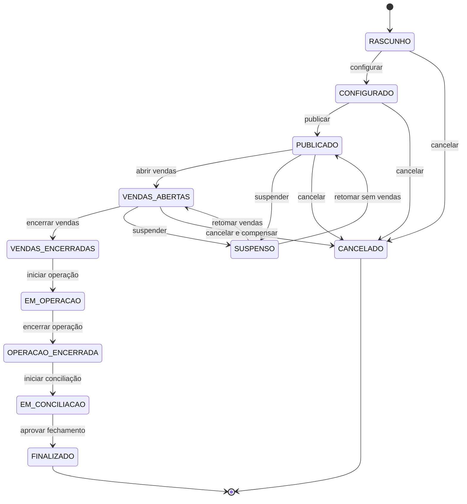

| Transição | Quem | Regras | Efeitos colaterais |
|---|---|---|---|
| Rascunho → Configurado | Gestor/Organizador | local, datas, políticas e responsáveis completos | `EventoConfigurado` |
| Configurado → Publicado | Gestor | pátios, capacidade e produtos válidos | snapshot de publicação; `EventoPublicado` |
| Publicado → Vendas abertas | Gestor/agenda | janela comercial | disponibiliza ofertas |
| Vendas abertas → Encerradas | Gestor/agenda | cut-off ou motivo | impede novas reservas |
| Vendas encerradas → Em operação | Supervisor | checklist operacional e contingência | ativa dashboards e dispositivos |
| Em operação → Operação encerrada | Supervisor | entradas encerradas, exceções listadas | fecha admissões normais |
| Operação encerrada → Em conciliação | Financeiro/Gestor | consolida fontes | cria fechamento pendente |
| Em conciliação → Finalizado | Financeiro + aprovador | divergências resolvidas/aceitas | imutabilidade, DRE e retenção |
| Estados pré-operação → Cancelado | Gestor | motivo e política | bloqueios, notificações, cancelamentos e reembolsos |

## 15.3 Reserva de inventário

**Situação implementada:** UC709 cria em `MANTIDA`, libera explicitamente para
`LIBERADA` e expira para `EXPIRADA` por job ou verificação transacional. Somente
`MANTIDA` consome o contador reservado. `CONFIRMADA` permanece para a história
de pedido/pagamento.

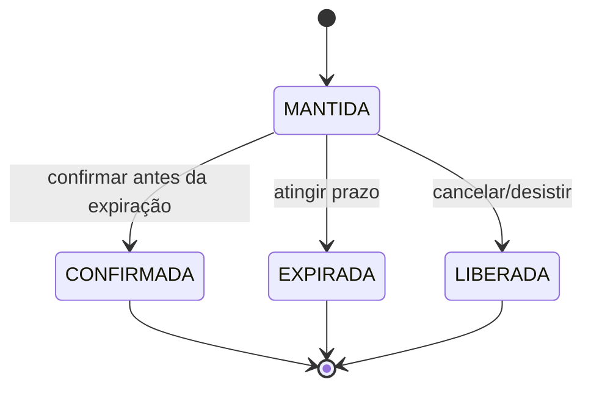

- Confirmação e expiração competem atomicamente.
- Somente `MANTIDA` consome saldo reservado.
- `CONFIRMADA` converte reservado em vendido.
- `EXPIRADA` e `LIBERADA` devolvem saldo uma única vez.
- Autor: sistema, cliente, caixa ou integração conforme origem.

## 15.4 Pedido

**Situação implementada:** a criação percorre `CRIADO → AGUARDANDO_PAGAMENTO`
na mesma transação, sem expor o estado intermediário ao cliente. Um job interno
materializa `EXPIRADO` quando o prazo herdado do hold termina. UC713 implementa
o cancelamento próprio: `CRIADO/AGUARDANDO_PAGAMENTO → CANCELADO` ou
`CONFIRMADO/ATENDIDO → EM_REEMBOLSO`. As transições financeiras posteriores
continuam TARGET.

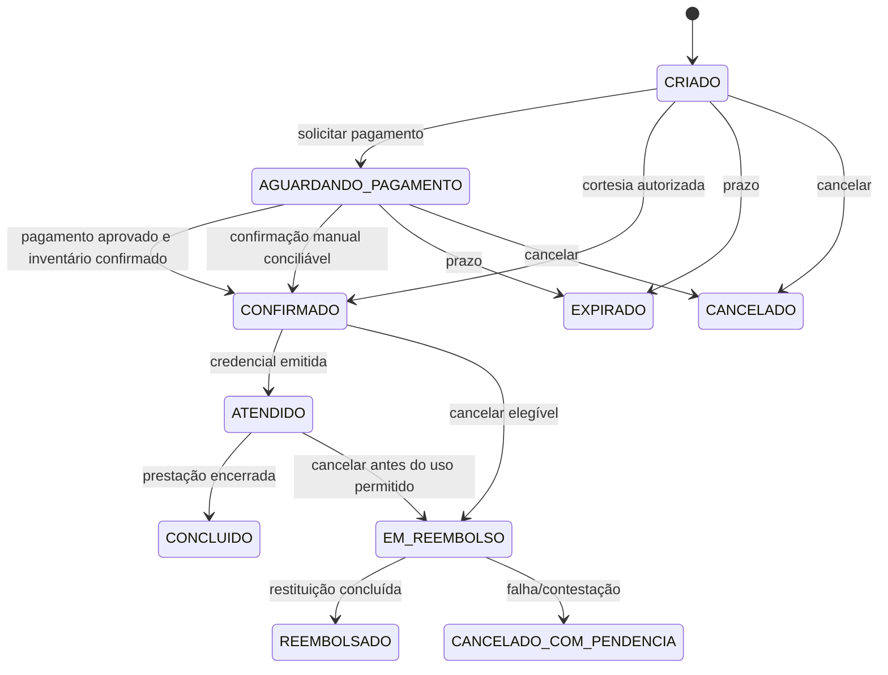

| Estado | Mutabilidade | Quem pode avançar | Efeito principal |
|---|---|---|---|
| Criado | itens ainda controlados pela reserva | Cliente/Caixa/Integração | total e snapshots definidos |
| Aguardando pagamento | preço e itens congelados | Payment process manager | inicia tentativas |
| Confirmado | imutável comercialmente | Policy de compra | solicita credencial |
| Atendido | credencial entregue | Credenciais | aguarda uso/conclusão |
| Em reembolso | sem novo uso | Cliente/Financeiro conforme política | bloqueia credencial e restitui |
| Concluído/Reembolsado/Expirado/Cancelado | terminal | sistema | preserva histórico |

## 15.5 Pagamento

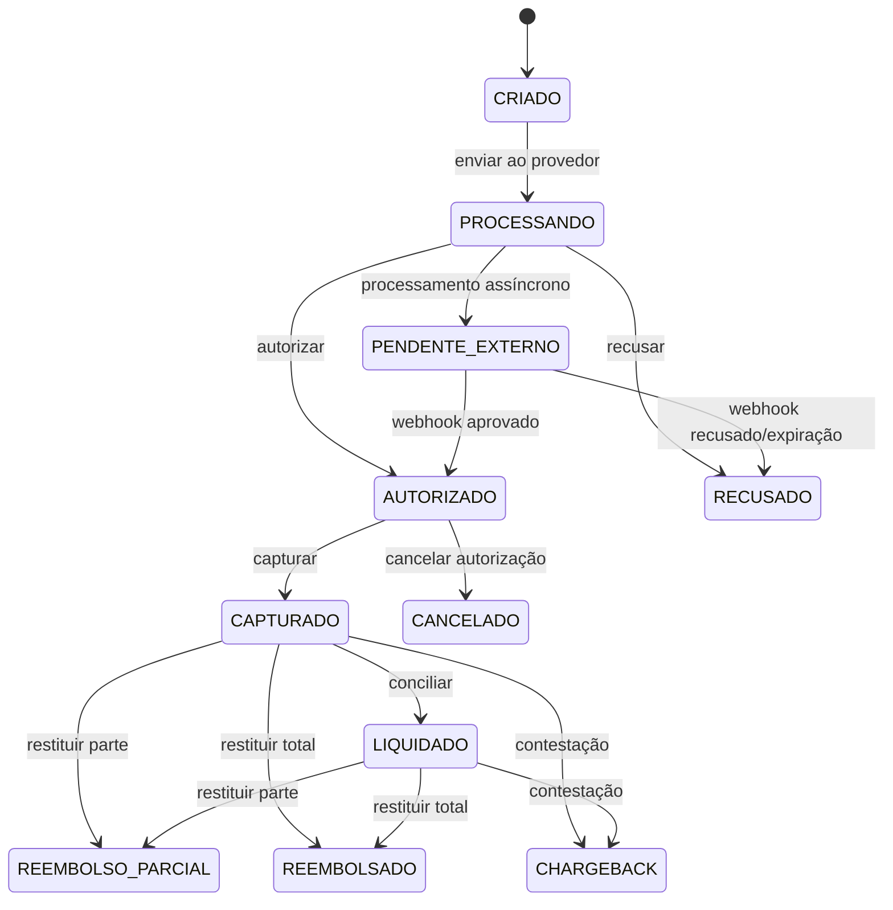

- Gateway/policy altera estados técnicos; operador não marca aprovação arbitrariamente.
- Confirmação manual exige permissão extraordinária, evidência e posterior conciliação.
- **AS-IS:** a confirmação manual versionada confirma o hold e o pedido na mesma
  transação e registra `PENDENTE_CONCILIACAO`; não altera a máquina de pagamento
  nem fabrica uma aprovação de provedor.
- Captura total ou parcial nunca supera autorização.
- Reembolso acumulado nunca supera captura.
- Webhook duplicado não repete evento de negócio.

## 15.6 Credencial

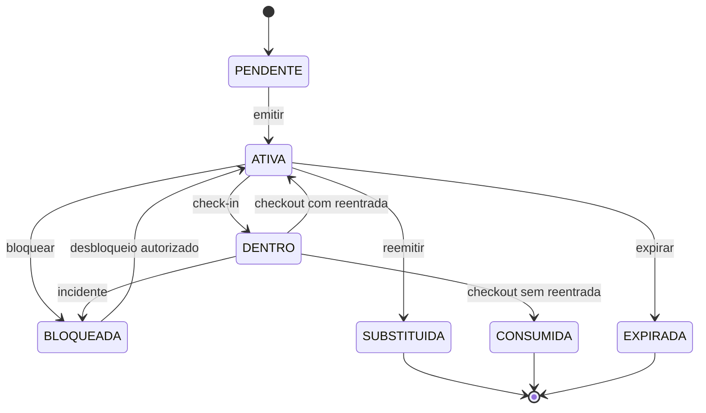

Regras:

- emissão: sistema após direito elegível; **AS-IS**, `PENDENTE → ATIVA` ocorre no
  mesmo caso de uso e uma credencial é criada por unidade do pedido;
- representação QR: **AS-IS**, somente credencial `ATIVA` com meio QR e validade
  futura pode incrementar `qrVersao`; a criação exige a versão esperada e o
  PostgreSQL admite somente uma representação ainda não revogada;
- bloqueio/desbloqueio: supervisor, atendimento autorizado ou policy antifraude;
- substituição: atendimento, revogando a representação anterior no mesmo commit;
- entrada/saída: controle de acesso;
- `DENTRO` descreve o direito, enquanto `Presenca` guarda o histórico físico detalhado.
- O código público AS-IS é somente identificador do agregado. Não substitui QR,
  placa validada ou RFID e nunca autoriza entrada isoladamente.

## 15.7 Tentativa de acesso

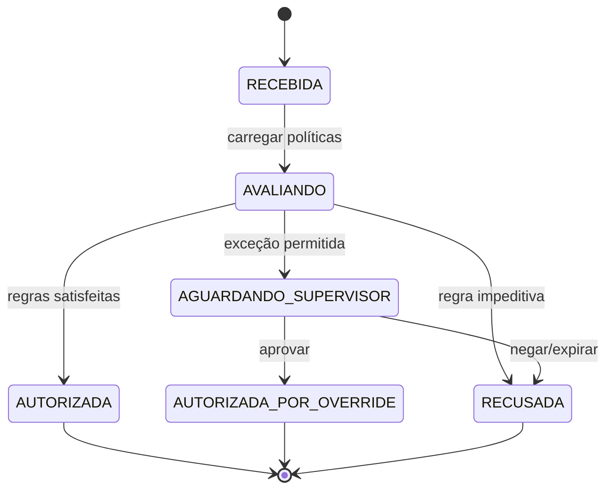

Toda decisão terminal contém código estável e motivo. Override exige usuário distinto do operador quando a política determinar.

**Situação implementada:** check-in e check-out QR online persistem
`RECEBIDA → AVALIANDO`
e uma decisão terminal `AUTORIZADA` ou `RECUSADA`. As recusas usam códigos
estáveis para representação inválida, credencial inativa, janela, estado do
evento, pátio, duplicidade e lotação. A autorização consome a credencial,
materializa presença e sessão, e incrementa a ocupação no mesmo commit. A saída
encerra presença e sessão, decrementa a ocupação e executa `DENTRO → CONSUMIDA`
ou `DENTRO → ATIVA` conforme a política publicada. Override,
placa, RFID, leitura sem consumo e sincronização offline continuam TARGET.

## 15.8 Movimentação/Sessão de estacionamento

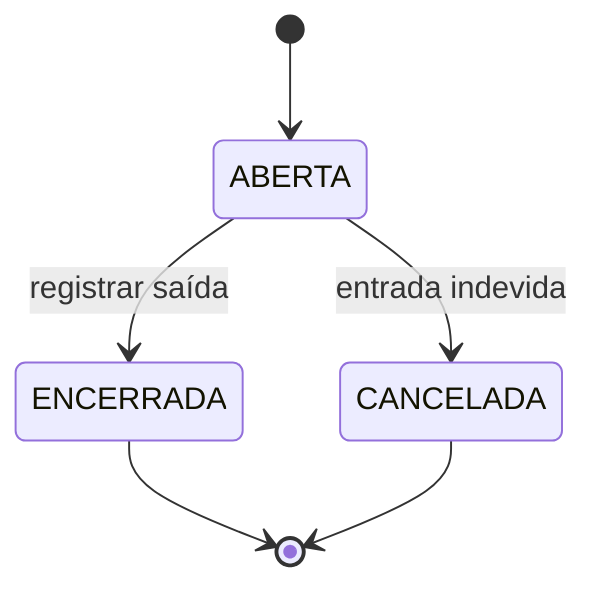

- **AS-IS:** `ABERTO → FECHADO` e `ABERTO → CANCELADO` já são protegidos.
- **TARGET:** pátio e origem do direito são obrigatórios; encerrada não reabre; ajuste posterior é entidade compensatória.
- Evento: valor normalmente é preço pré-pago, não cálculo de permanência.
- Rotativo: valor pode ser calculado no encerramento por snapshot tarifário.

**Situação implementada:** `SessaoEstacionamento` enterprise é aberta como efeito
da autorização QR, com organização, evento, pátio, credencial, pedido, item,
presença, tentativa e origem `PEDIDO_EVENTO`. A tabela e a API legadas de
`Movimentacao` permanecem inalteradas. UC717/UC719 encerram a sessão enterprise
no mesmo commit do check-out, sem cálculo tarifário para evento pré-pago.

## 15.9 Contrato mensalista

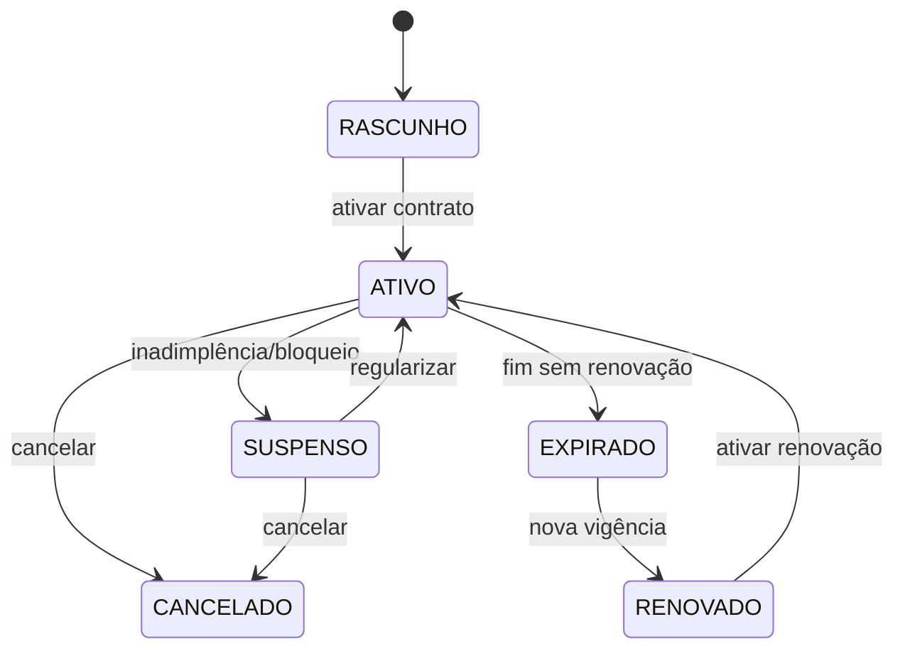

Somente `ATIVO` concede direito. A vigência efetiva deve ser conferida além do estado. Suspensão preserva contrato e acessos passados.

## 15.10 Documento fiscal

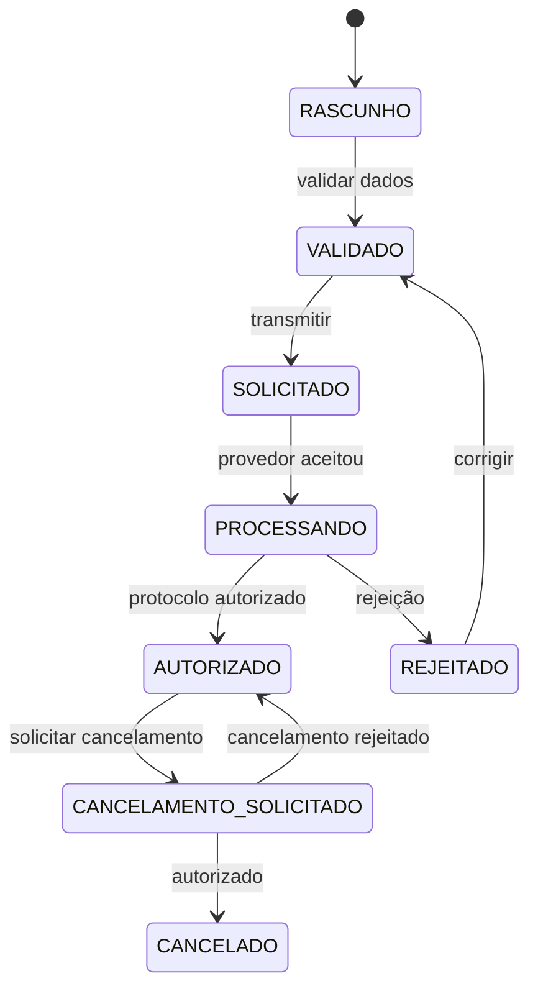

Fiscal tributário transmite/corrige; cancelamento exige permissão e justificativa. Documento autorizado não é editado.

## 15.11 Conta a receber e conta a pagar

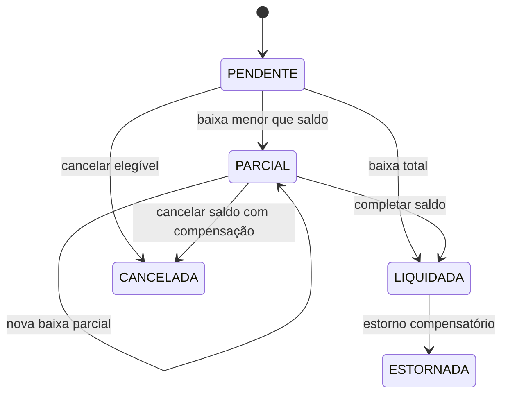

- Caixa/Financeiro registra baixa conforme escopo.
- Financeiro aprova cancelamento/estorno.
- Baixa acumulada não ultrapassa total.
- A implementação atual usa `PAGA` para pagar e `RECEBIDA` para receber; `LIQUIDADA` é o termo conceitual comum.

## 15.12 Caixa/turno

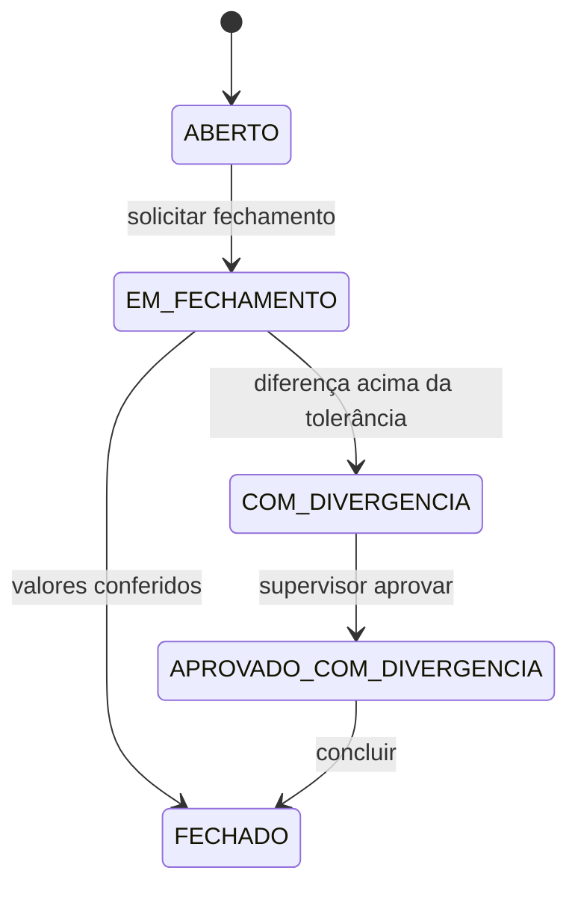

O operador fecha o próprio turno, mas não aprova divergência acima do limite. Venda retroativa após `FECHADO` é proibida.

## 15.13 Comando de equipamento

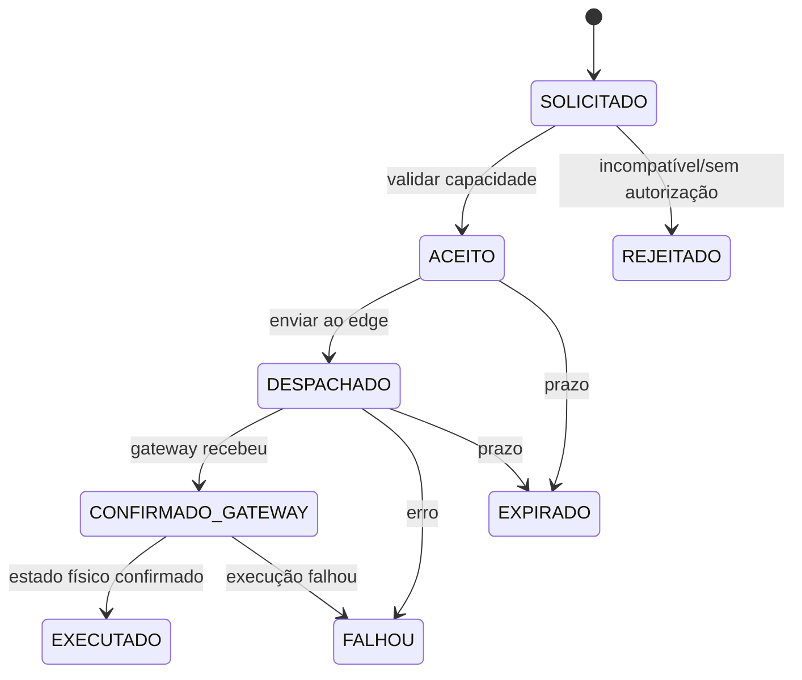

“Despachado” não significa “executado”. A confirmação física é separada e correlacionada.

## 15.14 Fechamento do evento

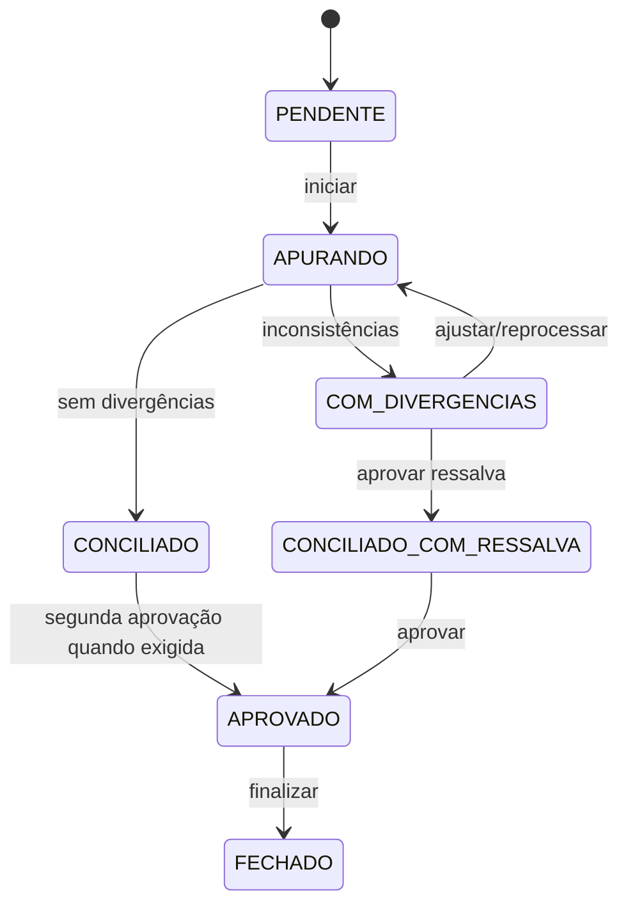

Fontes obrigatórias: inventário, pedidos, pagamentos, reembolsos, credenciais, acessos, movimentações, caixas, documentos fiscais, contas e repasses.

## 15.15 Membership de organização

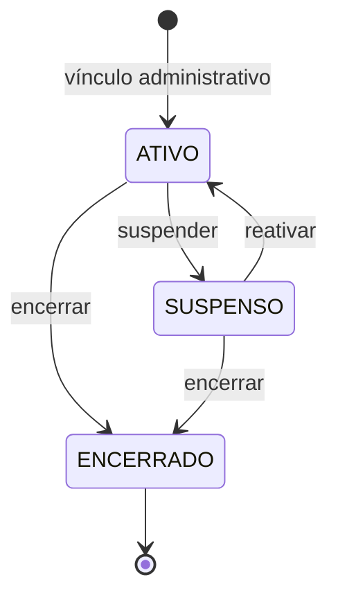

`ENCERRADO` é terminal: um vínculo posterior cria outro registro e preserva o
histórico. Suspensão, reativação e encerramento incrementam `@Version`, de modo
que qualquer JWT contextual emitido com a versão anterior deixa de autenticar.
O estado `PENDENTE` somente será introduzido quando convite, aceite e expiração
forem implementados.
