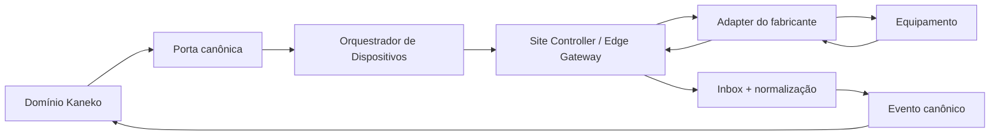
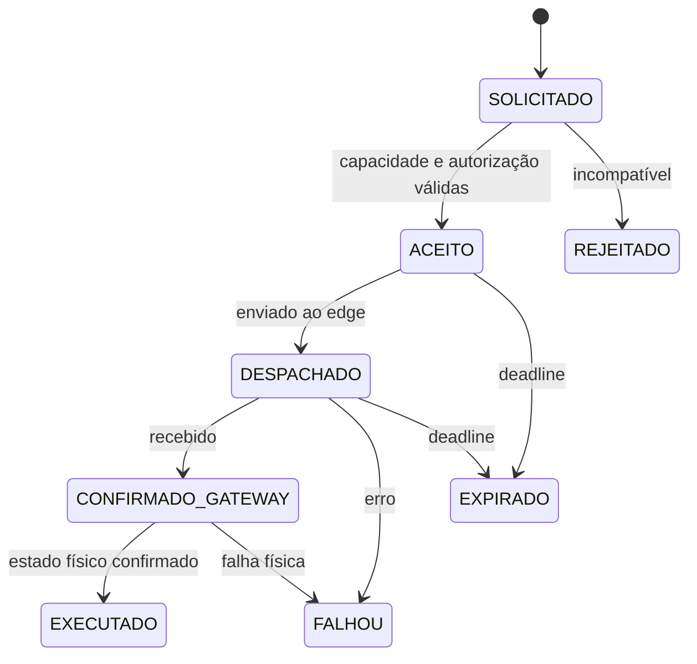
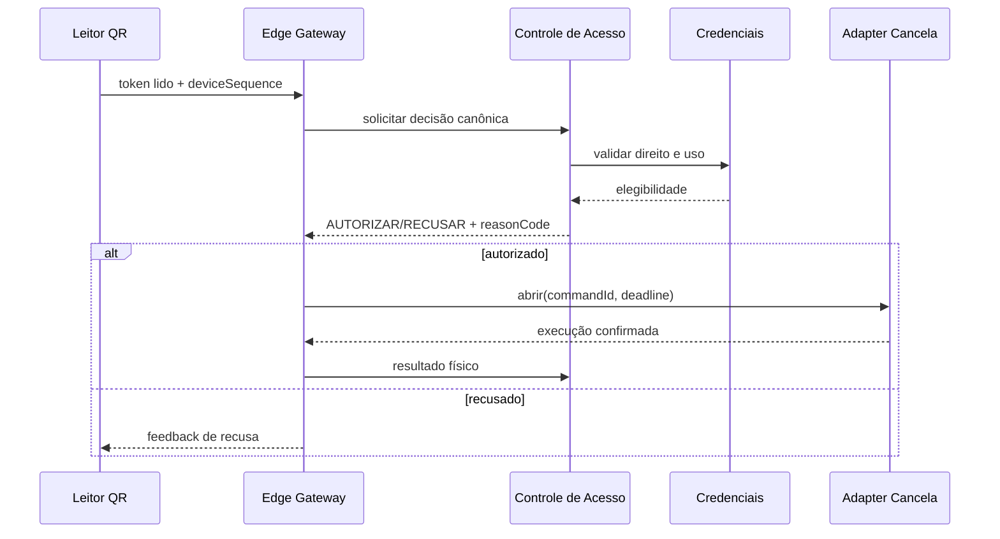
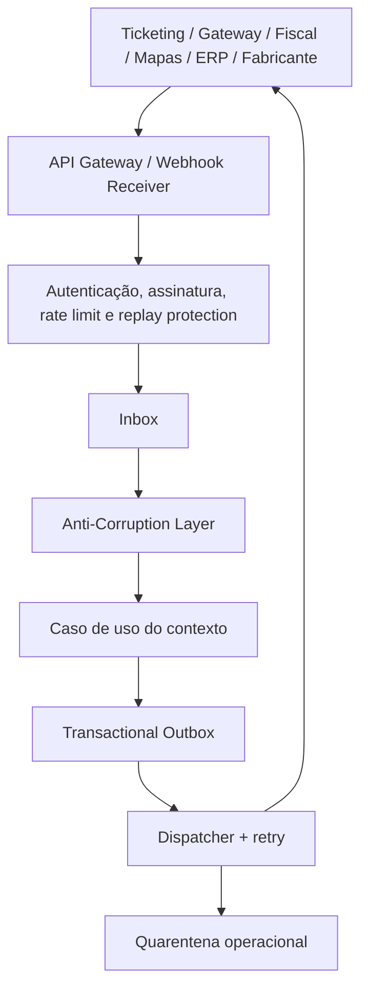

> Links: [[README]] · [[12-dominio-ddd]] · [[17-apis-enterprise]] · [[18-permissoes-rbac]] · [[20-roadmap-produto]]

# 19. Equipamentos e Integrações

## 19.1 Princípio de desacoplamento

Fabricantes não pertencem aos domínios Evento, Credencial, Pátio ou Movimentação. O domínio solicita uma capacidade canônica; uma Anti-Corruption Layer traduz para protocolo, SDK ou API do fornecedor.

## 19.2 Portas canônicas

| Porta | Operações conceituais | Implementações futuras |
|---|---|---|
| `BarrierActuatorPort` | abrir, fechar, travar, consultar posição | cancela, portão, semáforo integrado |
| `CredentialReaderPort` | receber token QR/RFID/NFC | leitor QR, RFID, smartphone |
| `VehicleIdentificationPort` | capturar placa e evidência | LPR/ANPR, OCR, integração veicular |
| `OccupancySensorPort` | presença, entrada/saída, vaga ocupada | laço indutivo, ultrassom, câmera |
| `PaymentTerminalPort` | iniciar/cancelar e receber resultado tokenizado | POS, totem, pinpad |
| `TicketMediaPort` | emitir/ler mídia transitória | ticket, código de barras, QR impresso |
| `DisplayPort` | vagas, direção, texto e alerta | painel LED, display de faixa |
| `PrintPort` | imprimir documento canônico e status | impressora térmica/documental |
| `EvidenceCapturePort` | solicitar imagem vinculada a finalidade | câmera de contexto |
| `DeviceHealthPort` | heartbeat, diagnóstico e versão | qualquer equipamento gerenciável |

## 19.3 Capacidades por equipamento

| Equipamento | Capacidades | Dados recebidos | Comandos | Política de falha típica |
|---|---|---|---|---|
| Cancela/portão | controle físico de faixa | posição, obstrução, ciclo, erro | abrir/fechar/travar | supervisor ou fail-safe explícito |
| LPR | identificação veicular | placa, confiança, país, imagem/ref | capturar/reconfigurar zona | QR/manual se confiança insuficiente |
| QR Reader | credencial | token, qualidade, instante | feedback visual/sonoro | entrada manual/offline cache |
| RFID/NFC | credencial persistente | UID tokenizado, instante | habilitar/desabilitar | meio alternativo |
| Sensor | ocupação e presença | estado, contagem, saúde | calibrar/consultar | projeção degradada e alerta |
| Totem | autosserviço | escolhas, ticket, pagamento | fluxo configurado | suporte/interfone |
| Painel LED | orientação | confirmação de exibição | texto, vagas, seta, alerta | sinalização estática |
| Impressora | comprovante/credencial | estado, papel, erro | imprimir | comprovante digital |
| POS | pagamento | resultado tokenizado | iniciar/cancelar | outro meio/caixa manual |
| Semáforo | fluxo | estado atual | vermelho/amarelo/verde | estado seguro configurado |
| Câmera | evidência | imagem/referência, timestamp | capturar | operação sem imagem conforme policy |

## 19.4 Ciclo de comando

Todo comando contém `commandId`, `idempotencyKey`, organização, instalação, capacidade, parâmetros canônicos, prazo, prioridade, correlação, origem da autorização e exigência de confirmação. “Enviado” nunca equivale a “executado”.

## 19.5 Edge e contingência offline

O edge gateway deve:

1. autenticar-se como dispositivo e validar a plataforma;
2. manter somente o conjunto mínimo de dados assinado;
3. verificar versão, validade e relógio do pacote;
4. decidir apenas capacidades autorizadas offline;
5. enfileirar eventos de forma criptografada;
6. preservar ordem por dispositivo/faixa;
7. possuir sequência local monotônica;
8. sincronizar com deduplicação e detecção de lacunas;
9. expor saúde e capacidade de armazenamento;
10. remover dados conforme retenção e confirmação central;
11. oferecer diagnóstico local autenticado;
12. nunca fornecer ao fabricante acesso direto ao banco central.

### Modos de falha por faixa

| Modo | Comportamento | Uso |
|---|---|---|
| `FAIL_CLOSED` | mantém bloqueio | proteção patrimonial quando segura |
| `FAIL_OPEN` | libera passagem | segurança física/evacuação quando determinada |
| `SUPERVISOR_DECISION` | aguarda intervenção | risco intermediário |
| `OFFLINE_POLICY` | decide pelo pacote local | operação normal durante perda de nuvem |

A escolha é configuração versionada por local/direção e auditada. Não pode ser inferida pelo adapter.

## 19.6 Fluxo QR/cancela

## 19.7 Fluxo LPR

1. Câmera publica placa, confiança e referência de evidência.
2. Adapter normaliza o payload para `PlateRecognized`.
3. Política decide se a confiança permite busca automática.
4. Credenciais procuram direito por placa no escopo do evento/pátio.
5. Havendo ambiguidade, a decisão vai ao operador; não se escolhe silenciosamente.
6. Acesso autorizado solicita o atuador.
7. Placa capturada e placa cadastrada ficam separadas na auditoria.

## 19.8 Arquitetura de integrações corporativas

## 19.9 Categorias de integração

| Categoria | Exemplos | Iniciação | Dados canônicos | Autenticação | Falha/retry |
|---|---|---|---|---|---|
| Ticketing | Sympla, Ticketmaster, Eventbrite | parceiro ou Kaneko | evento, produto, pedido, passe, status | OAuth/client credentials, assinatura | inbox, reconciliação e quarentena |
| Pagamento | Pix, cartão, adquirente | Kaneko + webhook | intenção, transação, captura, reembolso | segredo/certificado, assinatura | idempotência, backoff, consulta ativa |
| Fiscal | SEFAZ, prefeitura, provedor | Kaneko | documento, lote, protocolo, rejeição | certificado/token | contingência, polling e reprocessamento |
| Equipamento | SKIDATA, TIBA, HUB, Amano e outros | bidirecional/edge | capacidades, comandos, telemetria | identidade de dispositivo/mTLS | fila local e estado físico |
| Marketplace | canal próprio, ParkMobile/SpotHero futuros | ambos | oferta, disponibilidade, reserva, cancelamento | OAuth/scopes | controle de quota e reconciliação |
| Mapas/navegação | Google/Waze/outros | Kaneko/parceiro | local, rota, disponibilidade aproximada | API key/OAuth | cache e degradação |
| ERP/contábil | sistemas do cliente | eventos/exportação | lançamentos, centros, documentos | client credentials/SFTP seguro | lote, checksum e reconciliação |
| Comunicação | email, SMS, WhatsApp, push | Kaneko | template, destinatário, referência | token/provider | retry, opt-out e status de entrega |

## 19.10 Contrato de webhook

- validar assinatura antes de parsing de negócio;
- validar timestamp e janela antirreplay;
- registrar payload bruto protegido e hash;
- deduplicar `provider + organizationId + externalEventId`;
- responder rapidamente após inbox persistida;
- processar efeitos fora da thread HTTP;
- retry exponencial com jitter e máximo configurado;
- erros permanentes vão para quarentena;
- reprocessamento preserva o mesmo identificador lógico;
- segredo nunca aparece em log ou resposta.

## 19.11 Anti-Corruption Layers prioritárias

### Ticketing

Traduz evento/ingresso externo para referências do Kaneko. Um ingresso de evento não é automaticamente uma credencial de estacionamento; precisa haver produto, direito e mapeamento explícitos.

### Pagamentos

Traduz estados específicos de provedores para a máquina canônica. “Pago” externo só produz `PagamentoAprovado` após autenticação, valor, moeda, referência e idempotência.

### Fabricantes

Traduz equipamentos e protocolos para capacidades. O domínio não contém enums de marcas, códigos proprietários ou SDKs.

### Fiscal

Traduz documento de domínio para schemas municipais/estaduais e normaliza protocolos e rejeições sem espalhar particularidades no pedido ou financeiro.

## 19.12 Observabilidade operacional

Cada integração e equipamento publica:

- disponibilidade e latência;
- tentativas, sucessos e falhas por código;
- backlog, idade da mensagem mais antiga e quarentena;
- versão de adapter, firmware e schema;
- última sincronização;
- discrepâncias de reconciliação;
- correlação com evento, pátio, faixa, pedido, pagamento e acesso, sem dados sensíveis.
