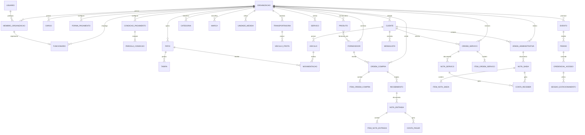
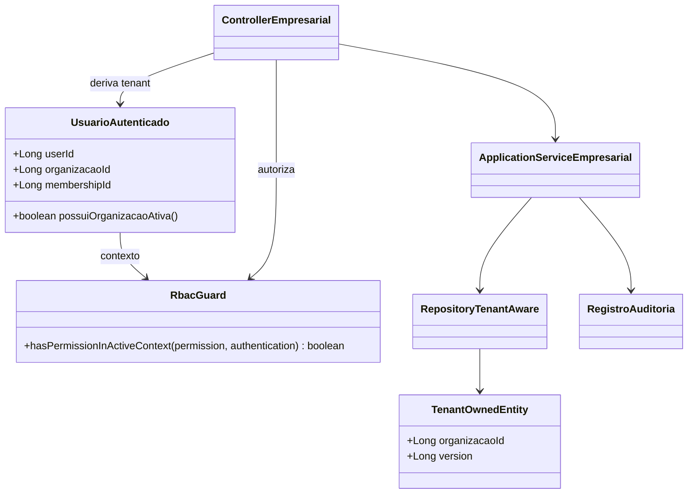
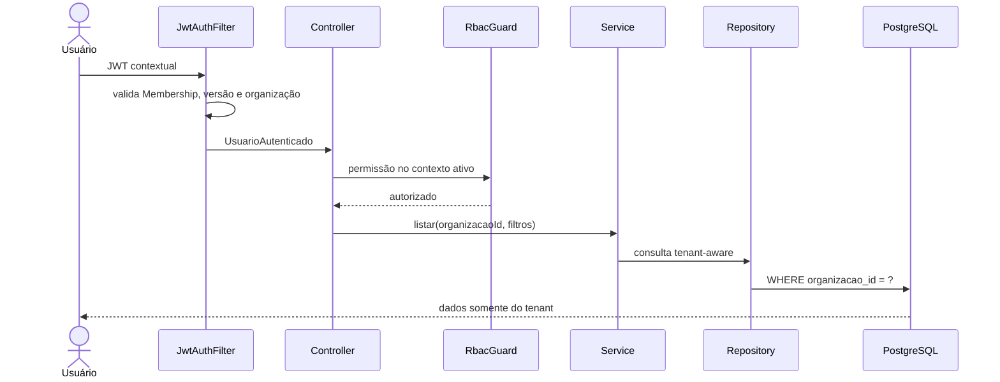
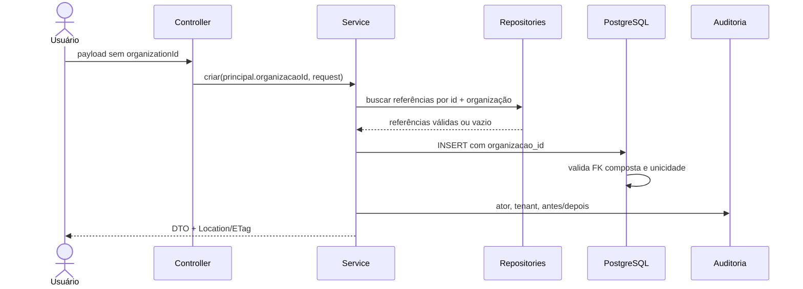

> Links: [[README]] · [[12-dominio-ddd]] · [[14-modelagem-dominio]] · [[16-casos-de-uso-plataforma]] · [[18-permissoes-rbac]] · [[20-roadmap-produto]] · [[21-status-implementacao]] · [[relatorio-conformidade]]

# 22. Unificação dos Módulos Empresariais e Multi-Tenancy

> Execução V55: Nota de Entrada, itens e Conta a Pagar possuem owner aditivo.
> A confirmação contextual exige Local de Estoque, cria `RECEBIMENTO` no razão
> V54 e não altera `produto.quantidade`; o histórico sem owner foi preservado.

## 1. Introdução

### 1.1 Finalidade

Este documento formaliza a evolução dos módulos empresariais existentes para o
mesmo modelo multiempresa já utilizado por Organização, Membership, RBAC,
Instalações, Eventos, Inventário, Pedidos, Credenciais e Acesso. Ele corrige a
interpretação de que os módulos anteriores seriam temporários: Fiscal,
Financeiro, Conveniência, Pessoas, Fornecedores, Logística, RH e Operação de
Pátio são capacidades permanentes do produto.

### 1.2 Escopo

Estão no escopo:

- ownership explícito por organização;
- isolamento no controller, service, repository e PostgreSQL;
- RBAC contextual por domínio;
- migração aditiva de dados e contratos;
- preservação das rotas `/api/*` durante a transição;
- integração entre operação, conveniência, fiscal, financeiro e eventos;
- especificação futura de Ordem de Compra e Ordem de Serviço como agregados
  distintos de notas fiscais.

Não estão no escopo desta fundação: associar automaticamente dados históricos a
uma organização, simular transmissão fiscal, pagamento capturado, gateway,
conciliação externa, equipamento ou operação offline.

### 1.3 Produto e empresa

O Kaneko é uma plataforma de gestão de estacionamentos operada por múltiplas
organizações. Cada organização pode administrar eventos, pátios, clientes,
fornecedores, produtos, serviços, estoque, documentos internos e obrigações
financeiras. A organização é a fronteira primária de segurança e ownership; o
evento é uma modalidade operacional interna a essa fronteira, e não um sistema
separado.

## 2. Análise do negócio

### 2.1 Problemas atuais

O código AS-IS possui dois modelos de ownership coexistentes. Os módulos
enterprise implementados após `V8__organizacao_tenant.sql` derivam a organização
do JWT contextual. As tabelas originadas em `V1__init_schema.sql`, `V6` e `V7`
permanecem globais, com unicidades e consultas sem organização. Isso produz os
seguintes problemas:

1. um usuário contextual pode consultar dados empresariais de outra organização;
2. o nome da organização no frontend não garante que a coleção exibida pertença a ela;
3. documentos iguais de empresas diferentes colidem em constraints globais;
4. referências podem cruzar clientes, fornecedores, produtos e documentos;
5. eventos não conseguem consolidar conveniência, fiscal e financeiro com
   linhagem confiável;
6. ocultar menus reduz funcionalidade, mas não corrige autorização.

### 2.2 Envolvidos

- administrador da plataforma: provisiona organizações sem operar seus dados;
- administrador da organização: governa cadastros, acessos e configurações;
- gestor: acompanha operação, vendas, estoque e resultado;
- compras: administra fornecedores, ordens e recebimentos;
- operador de estoque/conveniência: mantém catálogo, saldo e movimentos;
- operador de estacionamento: executa entrada, saída e atendimento;
- fiscal tributário: administra documentos e integrações fiscais;
- financeiro: administra títulos, baixas, conciliação e fechamento;
- RH: administra pessoas, cargos e vínculos laborais;
- auditor: consulta trilhas sem modificar origens;
- cliente: acessa somente seus próprios recursos quando houver identidade pública.

### 2.3 Usuários e responsabilidades

| Papel | Responsabilidade multi-tenant | Restrições principais |
|---|---|---|
| Administrador da plataforma | Provisionar tenant e primeiro vínculo | Não acessa dados empresariais sem contexto autorizado |
| Administrador da organização | Administrar todos os domínios internos | Não atravessa organização |
| Gestor | Operação, catálogo, estoque e relatórios | Sem administração de segurança por padrão |
| Compras | Fornecedores, ordens e recebimento | Sem baixa financeira incompatível com segregação |
| Estoque/Conveniência | Produto, serviço, saldo e PDV | Sem alterar documentos confirmados |
| Operador | Entrada, saída e movimentação | Sem preço, fiscal ou baixa financeira |
| Fiscal tributário | Documento fiscal interno/externo | Sem alterar estoque fora do workflow |
| Financeiro | Contas, baixas, conciliação e fechamento | Sem reescrever origem comercial/fiscal |
| RH | Cargo, funcionário e vínculo | Sem acessar credenciais de clientes |
| Auditor | Leitura de trilhas e relatórios | Sem comandos mutáveis |

## 3. DER de ownership

### 3.1 Relacionamentos principais TARGET

Ordem de Compra, Recebimento, Venda Administrativa e Ordem de Serviço aparecem
como entidades TARGET. Elas ainda não existem no código e exigem ADR, máquina de
estados e contrato próprios antes de migration.

### 3.2 Classes de ownership

| Classe | Regra | Exemplos |
|---|---|---|
| Global | Sem `organizacao_id`; compartilhado deliberadamente | `usuario`, `pais`, `estado`, `cidade`, `permissao`, `papel` |
| Raiz tenant | `organizacao_id` direto, imutável e obrigatório para novos registros | cliente, fornecedor, produto, serviço, documento, conta, movimento |
| Filho tenant | Owner inequivocamente derivado do pai; carrega `organizacao_id` quando precisa validar múltiplos pais | contato deriva do fornecedor; parcela, item fiscal e vínculo N:N carregam owner |
| Compatibilidade histórica | `organizacao_id` opcional somente para linhas preexistentes | tabelas migradas enquanto o backfill não foi decidido |

## 4. Requisitos funcionais da unificação

| ID | Requisito |
|---|---|
| RF-MT-001 | Derivar a organização exclusivamente do principal contextual validado. |
| RF-MT-002 | Listar, buscar, criar, alterar e inativar registros somente no tenant ativo. |
| RF-MT-003 | Responder 404 para ID inexistente ou pertencente a outro tenant. |
| RF-MT-004 | Rejeitar `organizationId` enviado pelo cliente em payloads empresariais. |
| RF-MT-005 | Permitir identificadores iguais em organizações distintas quando a regra é local ao tenant. |
| RF-MT-006 | Impedir no banco qualquer referência empresarial entre organizações. |
| RF-MT-007 | Preservar linhas históricas sem owner até reconciliação explícita e auditável. |
| RF-MT-008 | Manter URLs compatíveis enquanto controller, service e repository passam a ser contextuais. |
| RF-MT-009 | Auditar criação, alteração, inativação e transições materiais. |
| RF-MT-010 | Integrar compra, estoque, fiscal e financeiro pela mesma origem rastreável. |
| RF-MT-011 | Integrar venda/serviço, fiscal e contas a receber pela mesma origem rastreável. |
| RF-MT-012 | Consolidar evento, operação, conveniência e financeiro sem confundir seus agregados. |

Processos obrigatórios:

- selecionar tenant e resolver permissões;
- reconciliar ownership histórico;
- registrar compra e recebimento;
- confirmar nota de entrada e gerar efeitos de estoque/financeiro;
- registrar venda administrativa e seus efeitos;
- executar ordem de serviço e faturamento;
- operar estacionamento de evento, rotativo e mensalista por origens explícitas;
- fechar operação e produzir relatórios filtrados pela organização/evento.

## 5. Casos de uso transversais

### 5.1 Regras de negócio

- RN-MT-001: todo comando empresarial exige Membership ativa e permissão efetiva.
- RN-MT-002: o tenant do JWT não pode ser substituído pelo cliente.
- RN-MT-003: toda busca por ID empresarial combina `id` e `organizacao_id`.
- RN-MT-004: constraints únicas empresariais incluem `organizacao_id`.
- RN-MT-005: relações críticas usam FK composta com `organizacao_id`.
- RN-MT-006: linha histórica sem owner não aparece numa consulta contextual.
- RN-MT-007: backfill exige escolha explícita de organização, ator, motivo e auditoria.
- RN-MT-008: documento confirmado não muda de organização nem de origem.
- RN-MT-009: `Usuario` permanece global; vínculo laboral pertence à Membership.
- RN-MT-010: geografia permanece global e somente registros ativos podem ser referenciados.

### 5.2 UC731 — Manter cadastro empresarial no tenant ativo

**Atores:** usuário contextual com permissão do domínio.
**Pré-condição:** organização e Membership ativas.
**Pós-condição:** registro criado/alterado com ownership e auditoria consistentes.
**Ativação:** usuário acessa uma tela de cadastro empresarial.

**Fluxo principal:**

1. O frontend envia JWT contextual sem `organizationId` no corpo.
2. O filtro valida usuário, Membership, versão e organização.
3. O controller exige permissão contextual.
4. O service usa `principal.organizacaoId()` como argumento obrigatório.
5. O repository filtra por ID e organização.
6. O PostgreSQL valida unicidade e FKs compostas.
7. O service registra auditoria e devolve DTO.

**Fluxos alternativos:** listar com paginação; alterar com versão esperada;
inativar preservando histórico.

**Exceções:** E1 token global: 403; E2 tenant divergente: 404; E3 referência
cruzada: 404 na aplicação e violação de FK no banco; E4 duplicidade local: 409;
E5 payload tenta controlar tenant: 400.

### 5.3 UC732 — Reconciliar registro histórico sem organização

**Atores:** administrador autorizado de migração e auditor.
**Pré-condição:** registro possui `organizacao_id IS NULL`; destino está ativo.
**Pós-condição:** registro e seu grafo compatível recebem owner único e auditável.

**Fluxo principal:** identifica o grafo; simula conflitos; valida referências;
aplica owner em ordem transacional; registra ator, motivo, antes/depois e lote.

**Exceções:** E1 owner ambíguo: nenhuma alteração; E2 dependência em outro owner:
rejeição; E3 conflito de unicidade no destino: relatório sem backfill parcial.

Esse caso de uso é TARGET. Nenhum endpoint ou job correspondente existe no AS-IS.

Os guards imediatos instalados durante os retrofits proíbem qualquer sequência
manual de `UPDATE organizacao_id`; eles não implementam este caso de uso. A futura
UC732 deverá operar por migration ou procedure administrativa versionada:

1. identificar e bloquear o grafo completo e impedir novas escritas concorrentes;
2. exigir organização de destino ativa, ator, motivo e identificador do lote;
3. simular unicidades normalizadas e validar owners de todos os pais e consumers;
4. adicionar primeiro os carriers de owner nullable que ainda não existirem;
5. substituir os guards somente dentro da transação controlada e migrar raiz,
   filhos e consumers como uma unidade indivisível;
6. persistir auditoria e relatório de conflitos sem copiar PII desnecessária;
7. restabelecer e validar FKs/guards antes do commit; qualquer falha desfaz o lote.

Depois da reconciliação completa e comprovada, migrations próprias podem aplicar
`NOT NULL` e remover guards temporários. Até lá, não existe backfill manual seguro.

### 5.4 UC733 — Executar rota compatível com contexto organizacional

**Atores:** consumidor existente autenticado.
**Pré-condição:** JWT contextual válido.
**Pós-condição:** a URL anterior produz o mesmo contrato funcional sobre dados
do tenant, sem caminho de consulta global.

O token global somente pode acessar uma superfície temporária de reconciliação
explicitamente autorizada; não pode executar operação empresarial normal.

## 6. Protótipos funcionais

O shell deve conservar os grupos Eventos, Operação, Fiscal, Financeiro,
Cadastros, Conveniência, Logística, RH e Sistema. Cada item é filtrado por
permissão contextual e protegido também na rota direta.

Padrões obrigatórios de tela:

- listagem: tenant visível, paginação, filtros, vazio e erro distintos;
- cadastro/edição: nenhuma entrada de tenant, referências somente do tenant;
- detalhe: origem, status, versão, timestamps e ações permitidas;
- exclusão/inativação: confirmação e motivo quando auditável;
- relatórios: organização implícita e evento/pátio como filtros internos;
- reconciliação histórica futura: simulação, conflitos, lote e confirmação forte.

As telas atuais em `frontend/src/resources` são reutilizáveis, mas seus endpoints
não são considerados seguros até a conclusão da respectiva história backend.

## 7. Dicionário de dados da migração

### 7.1 Campos transversais

| Campo | Tipo | Obrigatório | Regra | Observações |
|---|---|---:|---|---|
| `organizacao_id` | `BIGINT` | Novos registros: sim | FK `organizacao(id)`; imutável | Inicialmente opcional para preservar histórico |
| `version` | `BIGINT` | Sim quando agregado mutável | valor não negativo | Origem do ETag/If-Match |
| `created_at` | `TIMESTAMPTZ` | Sim | definido na criação | Auditoria técnica |
| `updated_at` | `TIMESTAMPTZ` | Sim | atualizado em mutação | Não substitui auditoria de domínio |
| `ativo/status` | domínio existente | Conforme entidade | transições explícitas | Exclusão lógica quando já prevista |

### 7.2 Matriz de ownership AS-IS × TARGET

| Domínio/tabelas | AS-IS | TARGET | Dependência/constraint principal | Onda |
|---|---|---|---|---:|
| `pais`, `estado`, `cidade` | Global | Global | unicidades geográficas permanecem globais | 0 |
| `usuario` | Global | Global | login/e-mail globais; identidade não recebe tenant | 0 |
| `organizacao`, `membro_organizacao` | Tenant foundation | Preservar | fonte do contexto | 0 |
| `permissao`, `papel`, `papel_permissao` | Global estrutural | Preservar/ampliar | catálogo global, atribuição contextual | 0 |
| `cargo`, `funcionario` | Global | Tenant direto | cargo e CPF únicos por organização; funcionário liga à Membership | 1 |
| `forma_pagamento` | Global | Tenant direto | nome único por organização | 1 |
| `condicao_pagamento` | Global | Tenant direto | nome único por organização | 1 |
| `parcela_condicao_pagamento` | Filho global | Filho tenant direto | FK composta para condição e forma do tenant | 1 |
| `cliente` | Global | Tenant direto | documento único por organização | 1 |
| `fornecedor` | Global | Tenant direto | documento, condição e transportadora do tenant | 1 |
| `fornecedor_email`, `fornecedor_telefone` | Filho global | Filho tenant derivado | FK para fornecedor é ownership inequívoco; não duplicar owner sem necessidade | 1 |
| `transportadora`, `veiculo_frota` | Global | Tenant direto | documento/placa únicos por organização | 1 |
| `transportadora_veiculo_frota` | Vínculo global | Filho tenant direto | ambas as pontas no mesmo tenant | 1 |
| `categoria`, `marca`, `unidade_medida` | Global | Tenant direto | nome/sigla únicos por organização | 2 |
| `produto`, `servico` | Global | Tenant direto | códigos/nomes e referências locais ao tenant | 2 |
| `produto_fornecedor` | Vínculo global | Filho tenant direto | produto e fornecedor no mesmo tenant | 2 |
| estoque embutido em `produto.quantidade` | Saldo mutável | Razão de estoque tenant | todo delta possui origem e local | 2/4 |
| `patio` | Misto; tenant opcional | Tenant direto | eliminar novos registros sem owner | 3 |
| `veiculo`, `tarifa`, `mensalista` | Global | Tenant direto | cliente/pátio/veículo coerentes por tenant | 3 |
| `movimentacao` | Global | Tenant direto | pátio, veículo, tarifa e mensalista no tenant | 3 |
| `colaborador` | Global de pátio | Tenant direto | vínculo laboral canônico via Membership | 3 |
| `ordem_compra`, itens, `recebimento` | Inexistentes | Novos agregados tenant | ADR e máquina de estados antes do DDL | 4 |
| `nota_entrada`, `item_nota_entrada` | Global | Raiz/filho tenant | fornecedor, produto e condição do tenant | 4 |
| `conta_pagar` | Global | Tenant direto | origem fiscal/ordem no mesmo tenant | 4/6 |
| venda administrativa e itens | Inexistentes como agregado | Novo agregado tenant | contrato antes do DDL | 5 |
| `nota_saida`, `item_nota_saida` | Global | Raiz/filho tenant | cliente, produto e condição do tenant | 5 |
| `ordem_servico` e itens | Inexistentes | Novo agregado tenant | ADR e máquina de estados antes do DDL | 5 |
| `nota_servico` | Global | Tenant direto | cliente, serviço e origem no mesmo tenant | 5 |
| `conta_receber` | Global | Tenant direto | origem comercial/fiscal no mesmo tenant | 5/6 |
| `contas_pagar_avulsa` | Global | Tenant direto | fornecedor/forma no tenant quando presentes | 6 |
| relatórios legados | Consultas globais | Projeções tenant/evento | nenhuma agregação sem filtro de owner | 6 |
| eventos, inventário, credenciais e acesso | Tenant direto | Preservar/integrar | FKs compostas já existentes | transversal |
| `comprador_pedido` | Owner derivado do pedido | Filho tenant derivado | PK/FK com pedido é suficiente; consultas partem do agregado | transversal |
| `item_pedido` | Owner do pedido, referências escalares sem FKs | Filho tenant com integridade reforçada | adicionar owner carrier ou FKs equivalentes para produto/alocação/lote | transversal |

### 7.3 Estratégia física

Cada conjunto será migrado em quatro passos separados quando necessário:

1. coluna opcional, FK simples e índice por organização;
2. adaptação da aplicação para exigir tenant em novos registros;
3. ferramenta/lote explícito de backfill com relatório de conflitos;
4. FK composta, unicidade tenant-aware e `NOT NULL` após reconciliação completa.

Índices únicos globais antigos somente serão removidos quando o índice equivalente
por organização estiver ativo e o modo compatível não depender deles. Rollback é
lógico: desativar uso do novo contrato preservando colunas e dados já escritos.

## 8. Diagrama de classes técnico

`TenantOwnedEntity` representa o contrato conceitual. A implementação deve manter
campos explícitos nas entidades e não introduzir filtro Hibernate global que possa
ser esquecido, desabilitado ou ocultar queries administrativas de migração.

## 9. Diagramas de sequência

### 9.1 Consulta contextual

### 9.2 Comando com referência empresarial

## 10. Requisitos não funcionais

### 10.1 Segurança

- isolamento horizontal obrigatório em todas as operações empresariais;
- 401 para contexto JWT inválido, 403 para permissão ausente e 404 para recurso
  ausente ou fora do tenant;
- tenant nunca controlado pelo cliente;
- constraints de banco como segunda linha de defesa;
- nenhuma credencial ou token em log, seed ou auditoria.

### 10.2 Performance

- índices iniciados por `organizacao_id` para filtros dominantes;
- paginação em coleções; keyset para feeds volumosos;
- validação de referências em lote em processos com múltiplos itens;
- evitar N+1 em documentos e relatórios.

### 10.3 Disponibilidade e migração

- migrations aditivas e compatíveis com rolling deployment quando aplicável;
- nenhuma alteração de migration aplicada;
- backfill reiniciável, auditável e sem efeitos parciais;
- ausência de owner não pode derrubar a aplicação nem aparecer no tenant errado.

Para os retrofits marcados como incompatíveis com overlap, o rollout é coordenado:

1. produzir backup/checkpoint recuperável e executar consultas de invariantes;
2. fechar escritas e drenar todas as instâncias HTTP, schedulers e workers antigos;
3. confirmar zero processos da versão anterior antes de executar Flyway;
4. aplicar a migration e executar `flyway validate`, Hibernate `validate` e smoke tests;
5. iniciar somente binários compatíveis e verificar as invariantes novamente;
6. reabrir escritas e tráfego. O rollback é lógico; a versão antiga não deve ser
   reiniciada depois que existirem linhas tenant-aware.

### 10.4 Usabilidade

- shell único, sem esconder capacidades permanentes;
- estados de carregamento, vazio, erro, conflito e acesso negado distintos;
- fluxo móvel adequado para operação e desktop para gestão.

### 10.5 Escalabilidade

- modelo coluna por organização no banco compartilhado;
- consultas previsíveis e índices tenant-first;
- sem banco ou schema por tenant nesta etapa.

### 10.6 Backup e recuperação

- backup inclui ownership, auditoria e lotes de migração;
- restauração deve preservar integridade das FKs compostas;
- rollback de aplicação não remove colunas ou dados já migrados.

### 10.7 Auditoria e LGPD

- mutações materiais registram ator, organização, motivo, trace ID e estados;
- acesso administrativo a dados históricos sem owner é excepcional e auditado;
- relatórios e exportações respeitam tenant e minimização de dados pessoais.

### 10.8 Verificação obrigatória por módulo

Cada recorte migrado possui teste de API tenant com segurança real, teste de
constraint PostgreSQL e teste de upgrade de schema. A matriz mínima comprova:

- anônimo 401, token global 403 e papel insuficiente 403;
- tenant B recebe 404 para IDs de A e sua listagem não contém A;
- body/header não alteram o contexto;
- referência A → pai B falha na aplicação e na FK específica;
- chave duplicada em A falha, enquanto a mesma chave em A e B é permitida;
- linha histórica null permanece intacta e invisível a A/B;
- auditoria registra organização, ator, recurso e trace sem segredo;
- Flyway migra banco limpo e upgrade V37 → latest; Hibernate `validate` inicia.

Helpers de JWT/RBAC devem usar os endpoints reais de Membership e seleção de
organização. Assertions de banco verificam SQLSTATE e nome da constraint, não
apenas uma `DataIntegrityViolationException` genérica.

## Plano de refatoração executável

1. **Onda 0:** consolidar ownership, RBAC, estratégia de migration e testes-base.
2. **Onda 1:** formas/condições de pagamento; clientes; fornecedores; RH e logística.
3. **Onda 2:** catálogo de conveniência e razão de estoque.
4. **Onda 3:** operação de estacionamento com origens evento, rotativo e mensalista.
5. **Onda 4:** ADR de Ordem de Compra; ordem, recebimento, nota e contas a pagar.
6. **Onda 5:** venda administrativa; ADR de Ordem de Serviço; notas e contas a receber.
7. **Onda 6:** baixas, conciliação, despesas, relatórios e fechamento por evento.
8. **Onda 7:** consolidação de frontend, permissões e E2E ponta a ponta.

Cada história deve entregar verticalmente migration, entidade, repository,
service, RBAC, controller, OpenAPI, frontend, auditoria, testes e `brain`. Nenhuma
onda autoriza transmissão fiscal, pagamento real ou integração externa sem as
dependências registradas em [[bloqueios-externos]].

### 10.9 Estado de execução

Em 2026-08-03, a V38 concluiu a primeira fatia da Onda 1: formas, condições e
parcelas de pagamento agora possuem ownership aditivo, unicidade normalizada por
organização, RBAC contextual e proteção de FK composta dentro do agregado. O
backfill e o `NOT NULL` permanecem condicionados ao mapeamento explícito dos
dados históricos. Consumers fiscais e financeiros serão endurecidos nas ondas
próprias, sem remover o catálogo já migrado.

A V39 complementa o recorte sem modificar a V38: mantém uniques parciais para o
legado sem owner, rejeita `NULL → tenant` no agregado de parcelas, fecha DTOs
contra campos desconhecidos e restringe consumers ainda globais a formas e
condições também históricas. Um teste de schema isolado executa V1→V37, persiste
o grafo histórico e valida V38→V39 sem alterar IDs ou relacionamentos.

A V40 migra Cliente como raiz tenant direta, conserva a URL `/api/clientes`,
fecha o DTO contra campos desconhecidos, aplica `customers:read/manage` e exige
condição de pagamento da mesma organização. Documento continua único dentro do
tenant e também entre linhas históricas enquanto o backfill não ocorre. Consumers
globais aceitam somente clientes sem owner até suas respectivas migrations.

A V41 migra Transportadora como dependência imediata de Fornecedor. O documento
fica único por organização, a condição de pagamento exige o mesmo owner e as
rotas `/api/transportadoras` passam a usar `logistics:read/manage`. Frota e o
vínculo N:N não foram antecipados: seus serviços continuam aceitando somente
transportadoras históricas até a próxima fatia de Logística.

A V42 migra Fornecedor, preserva os filhos de contato por ownership derivado e
protege condição de pagamento e transportadora com FKs compostas e trigger de
compatibilidade. A API preservada exige `suppliers:read/manage`; documentos
permanecem únicos no tenant e no conjunto histórico separado.

A V44 adiciona a segunda defesa de compatibilidade: tabelas ainda globais só
podem referenciar fornecedores sem owner, e a reconciliação futura deve migrar o
grafo de forma atômica. A unicidade documental usa representação somente-dígitos
no banco. Como binários anteriores fazem consultas globais, o procedimento de
implantação dos retrofits exige drenagem completa da versão anterior; rolling
deployment com overlap old/new não é suportado nesta transição.

A V43 migra Cargo como primeira raiz de RH. A rota preservada `/api/cargos`
deriva owner do JWT, exige `workforce:read/manage`, normaliza a unicidade de nome
por organização e registra mutações com retenção RH. Cargos históricos continuam
com owner nulo; `FuncionarioService` e a proteção temporária no PostgreSQL não
permitem que Funcionário global referencie Cargo tenant-owned antes de sua
própria migração.

A V45 conclui o retrofit cadastral de Funcionário: a rota preservada
`/api/funcionarios` deriva owner do JWT, reutiliza `workforce:read/manage`, exige
Cargo do mesmo tenant e aplica CPF normalizado único por organização. O histórico
sem owner permanece intacto e invisível; `Usuario`, identidade global, só resolve
Funcionário também histórico até o vínculo laboral canônico por Membership.
Condição de pagamento não existe no modelo AS-IS/TARGET de Funcionário e, por
isso, não foi criada nem relacionada nesta migration.

A V46 executa preflight retroativo do grafo Cargo–Funcionário e aborta o upgrade
se houver owners divergentes. Também proíbe no PostgreSQL qualquer mudança direta
de `organizacao_id` em Cargo ou Funcionário. Como os guards são imediatos, eles não
constituem um mecanismo de backfill: UC732 deverá substituí-los somente dentro de
uma migration/procedure administrativa auditada, migrar o grafo inteiro na mesma
unidade transacional e restabelecer as invariantes antes do commit.

A V47 aplica a mesma disciplina ao agregado de Fornecedor. Se Nota de Entrada,
`conta_pagar`, `contas_pagar_avulsa` ou `produto_fornecedor` já apontarem para um
Fornecedor tenant-aware, o upgrade falha com a constraint lógica específica. O
mesmo ocorre quando condição de pagamento ou transportadora divergem do owner da
raiz. Após os preflights, `ck_fornecedor_owner_imutavel` bloqueia troca, remoção ou
atribuição direta de owner. O mecanismo futuro de UC732 deverá substituir o guard
somente dentro do procedimento transacional descrito acima.

A V48 migra Veículo de Frota e o vínculo Transportadora–Veículo como uma única
fatia logística. A placa usa unicidade normalizada por organização; o vínculo
carrega owner direto e FKs compostas garantem as duas pontas no mesmo tenant.
Preflights recusam colisões e grafos históricos já divergentes. Owners de veículo
e vínculo tornam-se imutáveis e o backfill isolado de Transportadora com frota é
bloqueado até UC732. Nenhum registro histórico recebe tenant automaticamente.

A V49 fecha a raiz Transportadora com `ck_transportadora_owner_imutavel`, sem
remover os guards específicos do grafo. A implantação de V48 e V49 não suporta
overlap com binários globais anteriores: todas as instâncias antigas devem ser
drenadas antes da nova escrita. UC732 é o único caminho futuro autorizado para
substituir temporariamente os guards e reconciliar o grafo completo na mesma
transação auditada.

A V50 inicia a Onda 2 pelo catálogo-base de Conveniência. `categoria`, `marca` e
`unidade_medida` recebem owner imutável, unicidades normalizadas separadas por
tenant e legado, RBAC `catalog:read/manage` e auditoria `CONFIGURACAO`. Produto
permanece global somente durante a transição e é protegido no service e no
PostgreSQL para resolver exclusivamente pais sem owner. Não há overlap seguro
entre o frontend tenant-aware desses catálogos e Produto global: o rollout deve
coordenar V50 com a migration seguinte de Produto antes de ativar a interface.

A V51 complementa obrigatoriamente a V50 com versionamento otimista, precondição
HTTP, unicidade normalizada do nome de Unidade de Medida e guards reversos para
os pais consumidos por Produto. V50 e V51 constituem uma única unidade de rollout;
Produto passa a ser a V52 e o frontend não deve ser ativado antes dela.

A V52 acrescenta Produto e Serviço tenant-aware. O owner é imutável,
Produto referencia somente pais do mesmo tenant e as APIs preservadas adotam
`@Version`, `ETag` e `If-Match`. Consumers fiscais e comerciais ainda globais
aceitam exclusivamente Produto/Serviço históricos no service e no PostgreSQL;
sua migração ocorrerá em fatias próprias. Nenhum saldo é recalculado ou migrado:
`produto.quantidade` permanece apenas como compatibilidade histórica.

A V53 completa o vínculo comercial ProdutoFornecedor. A migration adiciona owner
nullable apenas para histórico, versão otimista e FKs compostas same-owner para
Produto e Fornecedor, preservando a unicidade incondicional do par. Owner e pontas
são imutáveis. A API contextual usa `catalog:read/manage`, oculta registros
históricos e cross-tenant, exige parents ativos na criação/reativação e reutiliza
a mesma linha quando um par inativo é reativado. PUT/DELETE usam `If-Match`; POST
concorrente resolve o perdedor como `409`. Consumers fiscais globais continuam
restritos a Produto histórico e não foram ampliados.

A V54 cria a fronteira tenant-aware de Estoque sem alterar o fluxo fiscal
histórico. `local_estoque` é um local lógico; `saldo_estoque` mantém uma linha
por Produto/Local; `movimento_estoque` é razão append-only com origem, ator,
saldos anterior/posterior e compensação vinculada ao mesmo saldo. Constraints
compostas impedem referências cross-tenant, saldo negativo, troca de owner e
compensação incompatível. Ajustes usam idempotência, auditoria `OPERACIONAL`,
outbox e locks transacionais; o limiar considera a posição agregada por Produto.
O preflight recusa Produto tenant-aware com quantidade legada não zero. Notas e
relatórios legados continuam resolvendo somente Produtos históricos sem owner.
V50/V51/V52/V53/V54 formam um rollout backend coordenado antes da ativação
conjunta do frontend tenant-aware de catálogo e estoque.

O estado final da transação é protegido no PostgreSQL por constraints diferidas:
a primeira linha do razão parte de zero, cada `saldo_anterior` coincide com o
`saldo_posterior` anterior por ID e a posição materializada coincide com o último
movimento (ou zero sem movimentos). Escrita direta parcial é recusada. Locks de
Local coordenam inativação com ajustes; Produto com saldo não zero permanece
ativo. A origem manual incorpora ator e chave, enquanto a unicidade documental
continua independente do ator. Nenhuma dessas proteções altera notas/relatórios
históricos ou cria dependência Java de Conveniência para Estoque.
